# PyInterior 指南 —— 规则驱动的生活模拟室内（类 inZOI），PCG 图 + Python 节点

> 适用于：人和 AI。改规则、改户型、重跑、看结果，都从这里开始。
> 设计：`docs/superpowers/specs/2026-10-28-pyinterior-design.md`；计划：`docs/superpowers/plans/2026-10-28-pyinterior.md`。
> 分支 `pyinterior`，2026-10-28。多层房子（1–3 层、楼梯、露台）见 §8：设计 `docs/superpowers/specs/2026-10-29-pyinterior-storeys-design.md`，
> 计划 `docs/superpowers/plans/2026-10-29-pyinterior-storeys.md`，分支 `pyinterior-storeys`，2026-10-29。

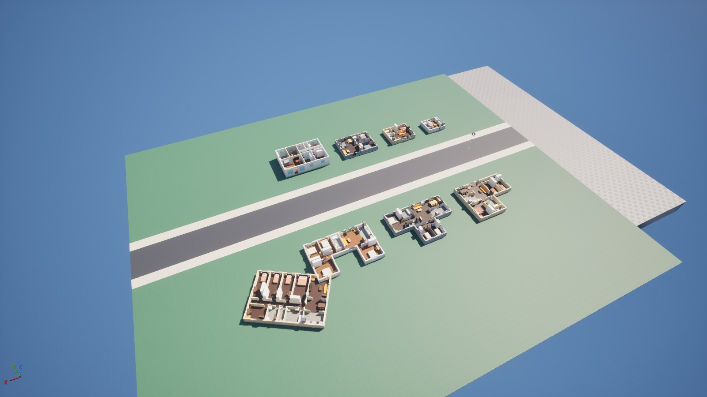

---

## 1. 结论

要验证的问题：生活模拟游戏（inZOI、The Sims 一类）的室内能不能用 PCG **按规则**生成，并且**改房子的外形和大小时，室内布局跟着
重新规划**；规则的组织方式要像 City Sample 的建筑一样（数据表 + 语法 + 模块）。

结论（编辑器实测，新关卡 `/Game/PyPCG/L_PyInterior`）：

- **可行。** 一栋房子 = 一个 PCGVolume + 它自己的一条闭合样条（足迹）。足迹 → 户型 → 分区 → 门 → 窗 → 家具 → 墙、地、门、窗、
  家具实例，一个 Python 节点每栋 0.02–0.18 s，原生 Static Mesh Spawner 落地。
- 8 栋示范房（单间、一室、两室、三室、L / T / U 形、转 120° 的四室）**全部 0 失败**，每栋 143–604 个实例。
- **改外形，布局跟着变**：同一栋房子依次改成 8 × 6.5 → 10.5 × 8 → 13 × 9 m → L 形，户型从一室 5 间 → 两室 7 间 → 三室 9 间
  → 三室 10 间，每一步都满足全部规则（下图）。
- **不出坏房子**：50 cm 步长扫过 4.5 × 5 到 20 × 14 m 的 635 个矩形外形 × 3 个种子（1905 个方案），全部合规；一个户型的必需家具
  摆不下时（比如厨房摆不下冰箱、水槽、灶），房子按删房间 / 降一档的同一条路退一步，而不是生成一个缺东西的房子。
- **实时编辑**：在视口里拖足迹样条的点，松开鼠标后这栋房子自己重新生成（组件的 Regenerate In Editor 开着；实测见 §5.4）。
- **规则驱动**：户型表、房间表、通行表、窗户语法、厨房台面语法、家具配方、风格表都是 `pypcg/interior/` 里的 Python 表，改一张表，
  所有房子跟着变。

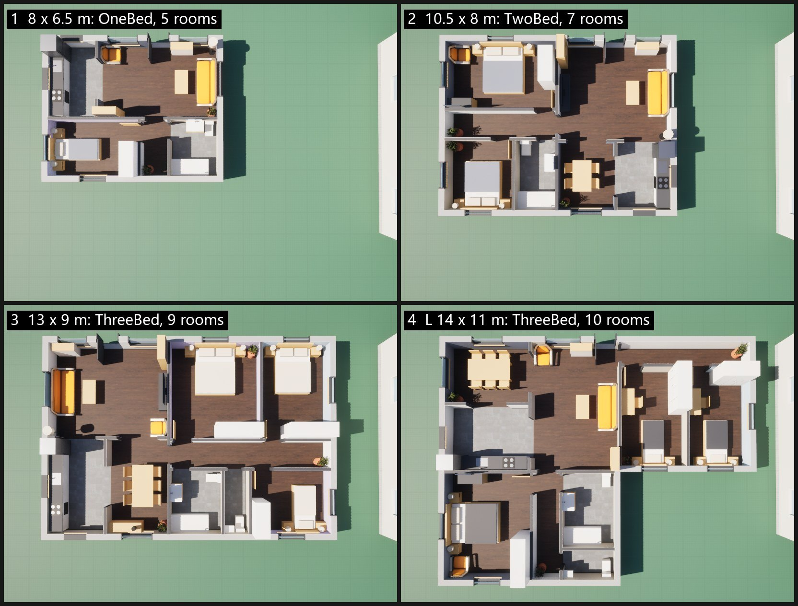

---

## 2. 和 City Sample 建筑的对应

| City Sample 建筑 | PyInterior | 文件 |
|---|---|---|
| 建筑样式数据库 BDF（样式码 → 规则） | 户型表 `PROGRAMS`（面积 → 房间清单与权重）、房间表 `ROOMS`（最小净尺寸、地面、窗型、墙色池）、通行表 `ACCESS`、风格表 `STYLES` | `interior/program.py` |
| 体块切分（楼层 / 分段） | 分区语法：公共区 / 私密区，私密区 Column / Gallery / Single / Double 模板 | `interior/layout.py` |
| 立面语法（`[S][W,S]*` 一类） | 窗户语法 `[S][W,S]*`、厨房台面语法 `[F][C]*[K][C]*[S][C]*`（同一个求解器 `pypcg/world/grammar.py`） | `interior/openings.py`、`interior/furnish.py` |
| 模块（墙段、窗框、转角） | 家具目录：尺寸、摆法、前方净空、基础几何拼装配方或 StarterContent 真网格 | `interior/catalog.py` |
| 样式码选模块与颜色 | 风格（Scandi / Warm / Modern）给墙色、地板、布艺、木色 | `interior/program.py` |
| 校验 | 不变量：每间可达、通道唯一、家具不重叠、不挡门、居室有窗 | `interior/checks.py` |

---

## 3. 构成

```
房子 actor（PCGVolume，tag PyInterior_House + 自己的名字）
 ├─ SplineComponent（闭合、直线段）= 足迹；actor 的前方 = 房子正面（正门那一侧）
 └─ PCGComponent → /Game/PyPCG/Interior/PCGI_House
      Get Spline Data (Self) ─┐
      Get Actor Data (Self) ──┴→ Python 节点 i01_house ─→ Parts（每个零件一个点：Mesh、Mat0）→ Static Mesh Spawner
                                                    ├→ Rooms（每间一个点：Type、Label、Area、Windows、Items、SizeX、SizeY）
                                                    └→ Summary（户型、间数、窗数、家具数、零件数、失败数）
```

| 文件 | 内容 |
|---|---|
| `Content/Python/pypcg/interior/footprint.py` | 足迹：样条 → 房子本地坐标（正面朝本地 −y）→ 网格格子 → 矩形翼（L / T / U）→ 外墙线段 |
| `interior/program.py` | 规则表（§4.2、§4.3、§4.4 的通行表、§4.9 风格与颜色） |
| `interior/layout.py` | 分区语法、房间尺寸、通行、打分 |
| `interior/doors.py` | 正门、门、门洞、开口 |
| `interior/openings.py` | 窗户语法 |
| `interior/catalog.py` | 家具目录、拼装配方、StarterContent 真网格表 `REAL`、房间配方 `RECIPES` |
| `interior/furnish.py` | 摆家具的规则 |
| `interior/assemble.py` | 墙、刷墙、踢脚、地面、门窗、家具 → 实例 |
| `interior/checks.py` | 不变量与 Summary |
| `interior/house.py` | 规划链一次跑完：分区 → 门 → 窗 → 家具；必需家具摆不下的方案退到下一个变体（§4.2） |
| `interior/graphs.py` | 图描述（DSL）→ `PCGI_House` |
| `interior/demo.py` | 示范街道的 8 栋房子与预设外形 |
| `pypcg/stages/i01_house.py` | 阶段模块（Python 节点跑的就是它；不 import `unreal`） |
| `Content/Python/pyinterior.py` | 编辑器驱动（§5.2） |
| `Content/Python/pyinterior_materials.py` | 46 个材质：2 个母材质 + 颜色 / 地板实例 |
| `Content/Python/pyinterior_probe_meshes.py` | 只读探针：StarterContent 网格的包围盒、材质槽、朝向（读顶点） |
| `Content/Python/pyinterior_live_probe.py` | 探针：只改样条并发属性变更通知、不调 generate，看房子会不会自己重算（改完用 `shape` 还原） |
| `Content/Python/pyinterior_dirty.py` | 列出编辑器里没存盘的包；`{"save_interior": true}` 只存 `/Game/PyPCG/Interior` 下的。StarterContent 的 `M_Chair`、`M_TableRound`、`M_Bush` 一渲染就变脏，别存：存了就和引擎原件不同，`starter_closure.py --copy` 会拒绝再拷 |
| `Content/Python/pyinterior_steps.py` | 出图用的分步预览（不存盘）：把一栋示范房按步骤（足迹、房间、门、窗、家具、真网格）临时搭在街道西边的草地上并截图；用的随机数和阶段相同，最后一步就是关卡里那栋房子。`{"step": "clear"}` 清掉临时物体，之后关卡不要存盘（trap 123） |
| `Tools/pyinterior/plan.py` | 离线平面图（不开编辑器） |
| `Tools/pyinterior/census.py` | 失败普查：50 cm 步长的全部矩形外形走一遍阶段的规划链，数失败和窄台面（改规则前后各跑一次） |
| `Tools/pyinterior/sheet.py` | 截图拼图 |
| `Tools/pyinterior/starter_closure.py` | 从引擎拷 StarterContent 子集到 `Content/StarterContent/`（不进 git） |
| `Tools/pypcg/tests/test_interior_*.py` | 离线测试（9 个文件） |

---

## 4. 规则

单位厘米。房子本地坐标：x 沿正面，y 往里，正面在 y = 0 一侧，朝 actor 的前方。

### 4.1 足迹

- 样条点（世界）换到房子本地坐标，在 `Grid`（默认 50 cm）网格上取中心落在多边形里的格子，取最大的 4 连通块、填洞。
- 贪心取最大矩形切成"翼"，比 2.5 m 窄的翼去掉后重切；得到直角外轮廓和外墙线段。斜边变成网格台阶。
- 下限（网格化后）：外包短边 ≥ 4.5 m、长边 ≥ 5 m、面积 ≥ 20 m²——4.5 × 4.5 m 的方块连墙算进去，放不下单间的起居室和卫生间；
  4.6、4.7 m 都会吸到 4.5。更小时节点只输出一条带错误的 Summary。外形够大但连单间都放不下（比如正面那一翼只有 2.5–3 m 深，
  放不下要开正门的起居室 / 客厅）也一样，错误里写明单间要多大的房间。

### 4.2 户型（按足迹面积）

| 户型 | 面积起点 | 公共区（权重） | 私密区（权重） | 放不下时先删 |
|---|---|---|---|---|
| Studio | 0 | 起居室 Main 4.0 | 卫生间 1.0 | — |
| OneBed | 34 m² | 客厅 3.0、厨房 1.3 | 卧室 2.2、卫生间 1.0 | — |
| TwoBed | 58 m² | 客厅 3.0、厨房 1.5、餐厅 1.4 | 主卧 2.6、卧室 2.1、卫生间 1.1 | 餐厅 |
| ThreeBed | 88 m² | 客厅 3.2、厨房 1.6、餐厅 1.6 | 主卧 2.7、卧室 2.1、卧室 2.0、卫生间 1.2、厕所 0.5 | 厕所 → 餐厅 |
| FourBed | 130 m² | 客厅 3.4、厨房 1.8、餐厅 1.8 | 主卧 2.9、卧室 2.1 / 2.1 / 2.0、卫生间 1.3、厕所 0.5、书房 1.5、洗衣房 0.8 | 洗衣房 → 书房 → 厕所 → 餐厅 |

目标面积 = 所在区面积 × 权重 / 区内权重和。一个户型在这个外形上放不下（某间达不到最小尺寸、没窗、到不了），就按上表删房间，
再不行降一档户型，最后是 Studio（`program.fallbacks`）。**家具也算**：分区、门、窗都合规但某间的必需家具摆不下（比如一个两面开口、
两面开窗的小厨房放不下冰箱、水槽、灶），这个方案作废，按同一条路退到下一个变体（`interior.house`，最多再试 3 个；都不行就用第
一个方案并在 Summary 里报出来）。第一次就成的房子和逐步调用完全一样。参数 `Program` 可以强制户型（放不下时同样往下退）。

### 4.3 房间

| 房间 | 区 | 最小净尺寸（短 × 长） | 最大长宽比 | 地面 | 窗型 |
|---|---|---|---|---|---|
| 起居室 Main（单间） | 公共 | 280 × 340 | 2.0 | 木 | living |
| 客厅 Living | 公共 | 300 × 340 | 2.0 | 木 | living |
| 厨房 Kitchen | 公共 | 180 × 220 | 2.8 | 砖 | kitchen |
| 餐厅 Dining | 公共 | 240 × 260 | 1.8 | 木 | dining |
| 主卧 Master | 私密 | 280 × 300 | 1.7 | 木 | bedroom |
| 卧室 Bedroom | 私密 | 240 × 270 | 1.8 | 木 | bedroom |
| 书房 Study | 私密 | 200 × 240 | 2.0 | 木 | bedroom |
| 卫生间 Bath | 服务 | 140 × 180 | 1.6 | 砖 | high |
| 厕所 WC | 服务 | 85 × 130 | 2.2 | 砖 | high |
| 洗衣房 Laundry | 服务 | 140 × 160 | 2.0 | 砖 | high |
| 走廊 Corridor | 交通 | 分区线上宽 130（净宽 ≥ 95） | — | 木 | — |
| 储藏间 Storage | 填充 | 90 × 100 | 3.5 | 木 | — |

净尺寸 = 墙以内。外墙 25、内墙 12；分区线落在 10 cm 上。

### 4.4 分区语法与通行

```
House   -> [Public | Private]          单翼沿长轴切；L / T / U 逐翼分
Public  -> 一到三间公共房：前后、并排或一排
Private -> Column  [Room]*              沿区界一列，每间都从公共区进
         | Gallery [Corridor | Row]     区界上一条走廊，后面一排房
         | Single  [Corridor | Row]     从区界伸进去的走廊，旁边一排房
         | Double  [Row | Corridor | Row]
           （Single / Double 可带一间横跨走廊尽头的尽端房）
Row     -> [Room]*                      按目标面积分宽度，每间不小于最小尺寸，单靠房间会太长时补储藏间
```

每个候选整体检查：最小净尺寸；居室（起居室、客厅、主卧、卧室）至少 90 cm 能开窗的外墙（离房间角 40 cm 以内的不算）；从正门
经允许的通道能到每一间；主卧是最大的卧室。合格的打分（面积误差、长宽比、交通面积、通行代价：每往通行表偏好列表后退一步加 0.15），
差 3 % 以内算平分、由 Seed 挑。

| 房间 | 可以从这些房间进（按偏好） |
|---|---|
| 客厅 / 起居室 | 正门 |
| 厨房 | 餐厅、客厅、起居室、走廊 |
| 餐厅 | 客厅、厨房、起居室 |
| 走廊 | 客厅、餐厅、起居室、走廊 |
| 主卧 | 走廊、客厅、餐厅 |
| 卧室 | 走廊、客厅、餐厅、起居室 |
| 书房 | 走廊、客厅、餐厅 |
| 卫生间 | 走廊、客厅、起居室、餐厅、主卧、卧室 |
| 厕所 | 走廊、客厅、餐厅、厨房 |
| 洗衣房 | 厨房、走廊、餐厅 |
| 储藏间 | 走廊、起居室、客厅、厨房、餐厅、主卧、卧室、书房 |

### 4.5 门

| 类型 | 宽 | 规则 |
|---|---|---|
| 正门 | 100 | 入口房间正面外墙净宽的中间；这面墙是房间唯一能开窗的墙时，挪到靠房子中间的一端 |
| 门（卧室、书房等） | 90 | 有门扇，放在离父房间入口近的一端，铰链在那端，向子房间开；画成开着的（扇转进房间，扫过的地面本来就空着） |
| 卫浴门 | 80 | 推拉门，不占地；画成关着的（门扇在门框之间、墙厚正中） |
| 门洞（进走廊） | 90 | 有门框、无门扇，居中 |
| 开口（客厅 / 厨房 / 餐厅之间） | 100–180 | 无门扇，居中；中间 90 cm 留作通道 |

门高 210，离共享墙两端 ≥ 15 cm；门扇扫过的地面、门洞和开口前 60 cm 不放家具。

### 4.6 窗（墙语法 `[S][W,S]*`）

| 窗型 | 宽 | 窗台 | 高 | 窗间墙 |
|---|---|---|---|---|
| living | 160 | 50 | 170 | 110 |
| dining | 140 | 70 | 150 | 100 |
| bedroom | 120 | 90 | 130 | 100 |
| kitchen | 100 | 105 | 110 | 80 |
| high（卫浴） | 60 | 150 | 60 | 80 |

每间房的每段外墙单独求解：W 定宽、S 可伸缩，取让 S 的缩放最接近 1 的窗数，墙越长窗越多；离房间角 40 cm、离同墙上的门 40 cm；
墙太短放不下整窗时放一扇窄窗（最窄 60 %）。

### 4.7 家具

| 房间 | 配方（加粗 = 必需，按顺序摆） |
|---|---|
| 起居室（单间） | **厨房台面**、**床组**、沙发组、小餐桌、盆栽 |
| 客厅 | **沙发组**、鞋柜、书架、扶手椅、落地灯、盆栽 |
| 厨房 | **厨房台面**、岛台、小餐桌 |
| 餐厅 | **餐桌组**、餐边柜、盆栽 |
| 主卧 | **床组**、衣柜、梳妆台、扶手椅、盆栽 |
| 卧室 | **床组**、衣柜、书桌组、盆栽 |
| 书房 | **书桌组**、书架、扶手椅、盆栽 |
| 卫生间 | **浴缸**（放不下换淋浴）、**马桶**、**洗手台**（放不下换小台盆） |
| 厕所 | **马桶**、小台盆 |
| 洗衣房 | **洗衣机**、烘干机、搁架 |
| 走廊 | 玄关桌、盆栽 |
| 储藏间 | 搁架 |

每间房记三类矩形：家具占的、保留的（门扇扫过区、通道前的地面）、软的（每件家具前面要的地面）。家具不能压任何一类；家具前面要的
地面只能和软的、保留的重叠。靠墙件沿每面墙 10 cm 一步滑动，居中件在房间中间的网格上找位置，每组按自己的规则打分：

- 床组：床头靠墙、不靠门那面墙、最好对着门、居中；两侧床头柜放得下才放；够宽放双人床，不够放单人床。单间先试靠墙的单人床。
- 衣柜：放得下的最宽一档，靠没有窗的墙、靠墙角，最好在门那面墙。
- 沙发组：沙发靠墙，对面 2.4–5 m 有空墙放电视柜，茶几在中间，铺地毯。
- 餐桌组：放得下椅子、椅子后有 60 cm 拉开的最大一张桌子。
- 厨房台面：语法 `[F][C]*[K][C]*[S][C]*` 铺最长的空墙（台面伸缩，冰箱不挡窗），台面上挂吊柜；墙短时用 `[K][C]*[S]`，冰箱另放；
  唯一不挡窗的墙角两边都要时，冰箱先站进去、短台面再铺剩下的墙；还不行就三件分开放，所有顺序都试。塞不满一整块台面的零头留空
  （不出 10 cm 的台面）；摆不下的整组不留任何占位。厨房前留 90 cm（单间 75 cm）。
- 卫浴：浴缸从墙角沿一面墙放满，否则墙角放淋浴；洗手台靠门，马桶不对着门；湿区前留 55 cm。
- 必需件按所有顺序尝试，再试替代件；高家具只挡窗台比它顶低的窗。

### 4.8 拼装

- 外墙在足迹线以内 25 cm，内墙 12 cm 在分区线上；水平段占转角，内墙碰到外墙就截在外墙内面（分区线离凹角只有几十厘米时也不会
  伸进转角），任意两段墙不重叠（俯视墙顶不闪）。
- 墙在门处切到 210，在窗处切出窗台到窗顶。
- 每间房把自己的四面墙刷 1 cm 自己的颜色（风格的墙色池，和父房间不同色），8 cm 踢脚；地面按房间类型；每个翼下 30 cm 基座。
- `WallCut` > 0：所有墙降到这个高度（生活模拟的"降墙"视图），门框、窗框剪到墙高，高于墙的挂墙件（吊柜、镜子）不出。
- 材质：`/Game/PyPCG/Interior/Materials` 下 46 个实例，母材质 `M_PyInt_Color`（颜色）和 `M_PyInt_WorldTex`（StarterContent 贴图按
  世界 XY 投影，拉伸的方块纹理密度一致）。

### 4.9 StarterContent 真网格（参数 `RealMeshes`，默认开）

| 目录项 | 网格 | 实测包围盒 | 朝向 | 缩放到 |
|---|---|---|---|---|
| 沙发 Sofa / Sofa_Small | `SM_Couch` | 82 × 272 × 115 | 正面 +X（靠背在 −X） | 220 × 92 × 85 / 170 × 88 × 85 |
| 扶手椅 Armchair | `SM_Chair`（休闲椅） | 82 × 81 × 115 | 正面 +X | 85 × 85 × 85 |
| 两人餐桌 Table_2 | `SM_TableRound` | 123 × 123 × 70 | 对称 | 80 × 75 × 75 |
| 盆栽 Plant 的叶冠 | `SM_Bush` | 113 × 122 × 138 | 对称 | 50 × 50 × 87（盆还是圆柱） |

包围盒和朝向由 `pyinterior_probe_meshes.py` 量出（Geometry Script 读顶点，高处顶点偏向靠背一侧），写在 `catalog.REAL`；阶段模块按它把网格
转正、逐轴缩放到目录尺寸，用网格自己的材质（`Mat0` 留空）。每件仍保留拼装配方，`RealMeshes` 关掉就全部回到拼装件（没有
StarterContent 的工程要关）。`SM_Shelf`（2 m 长的挂墙隔板）和 `SM_Lamp_Wall`（壁灯）没用：目录里没有挂墙装饰的位置。

| 拼装件 | StarterContent 真网格 |
|---|---|
| 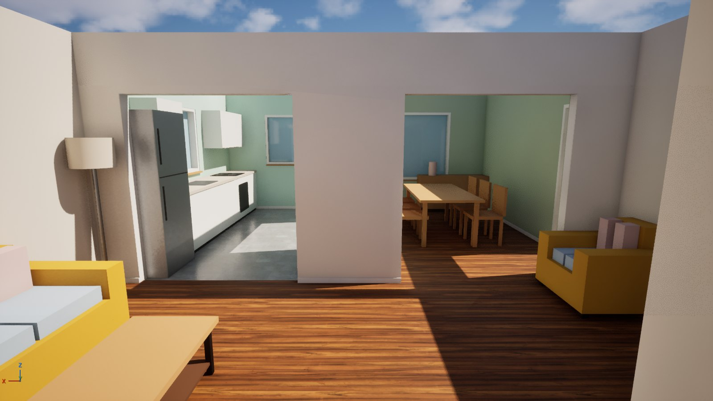 | 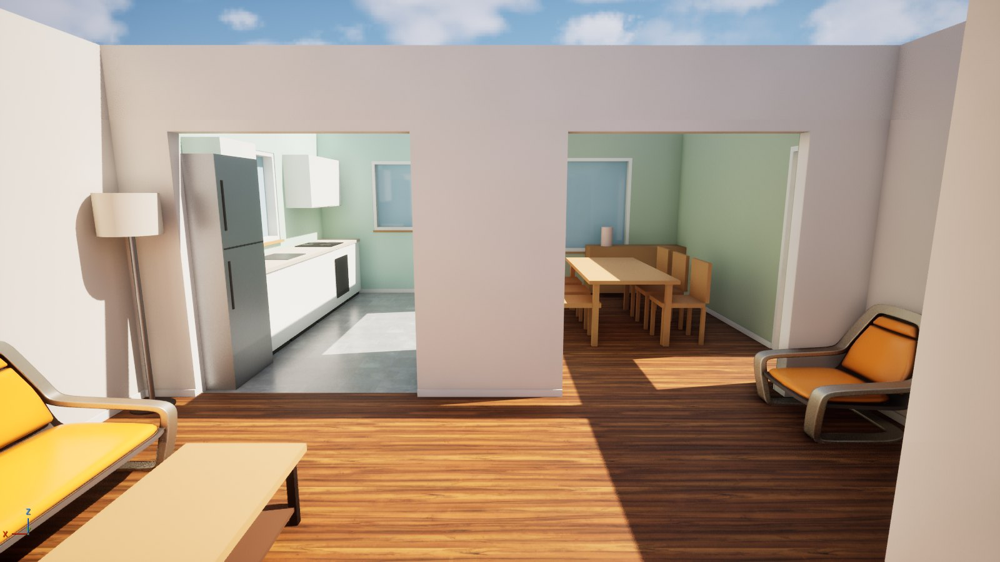 |

### 4.10 不变量

每间可达；除入口外每间正好一个进入它的通道；有正门；家具互不重叠（椅子塞进桌下、凳子塞进岛台除外）；家具不进门扇扫过区和
通道前；居室有窗。违反的写进 Summary（`failures`、`first_failure`），房子照样生成。

---

## 5. 怎么用

### 5.1 离线（不开编辑器）

```powershell
C:\Python314\python.exe -m pytest Tools/pypcg/tests -q -k interior
C:\Python314\python.exe Tools/pyinterior/plan.py --demo --sweep     # Saved/Reports/pyinterior_plan_<外形>.png、pyinterior_sweep.png
C:\Python314\python.exe Tools/pyinterior/plan.py --rect 1200x800 --seed 3
C:\Python314\python.exe Tools/pyinterior/census.py                  # 约 3 分钟；有失败或窄台面时退出码 1
```

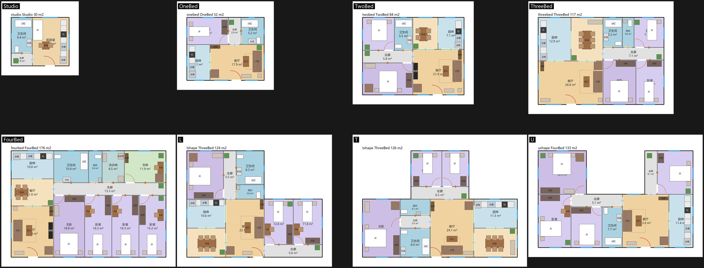

### 5.2 编辑器（`pyinterior.py`，一次调用一个阶段）

| 阶段 | 作用 |
|---|---|
| `level {"reload"?}` | 新建（从 `Template_Default`）或打开 `/Game/PyPCG/L_PyInterior`；`reload`：从磁盘重新打开（地图有没存的改动时拒绝） |
| `build` | 生成 `/Game/PyPCG/Interior/PCGI_House`，0 diffs 才存 |
| `site` | 草地、马路、人行道 |
| `houses` | 8 栋示范房：每栋一个 PCGVolume + 闭合样条（`SubobjectDataSubsystem` 加的实例组件） |
| `assign {"params": {...}, "house"?}` | 挂图、种子、风格和参数覆盖；**每次 `build` 之后要重跑** |
| `gen {"house"?}` | 生成（先 `pcg.FlushCache`） |
| `read {"house"?}` | Summary、Rooms、实例数 → `Saved/Reports/pyinterior_read.json`；生成是异步的，`gen` 之后隔一次调用再读 |
| `shape {"house", "shape" \| "size" \| "points"}` | 换外形并重新生成 |
| `shot` | 截图：`overview`、`top`、`angle`、`room`（站在某间房的墙角、眼睛高度，房间来自 Rooms 输出）、`fixed`（给 `eye` / `rot`） |
| `status` | 每栋的样条点数、图、是否已生成、实例数 |
| `save` | 存关卡（两条街 15 栋，3.7 MB，带生成结果） |

从零开始：`starter_closure.py --copy` → 启动编辑器 → `pyinterior_materials.py` → `pyinterior.py level` → `build` → `site` → `houses`
→ `assign` → `gen` → `read`。

### 5.3 参数（房子 PCG 组件的 Graph Parameters）

| 参数 | 默认 | 作用 |
|---|---|---|
| `WallHeight` | 270 | 墙高 |
| `WallCut` | 0 | > 0 时所有墙降到这个高度（"降墙"视图）；示范关卡里 House_04 是 0，其余 110 |
| `ExteriorWall` / `InteriorWall` | 25 / 12 | 墙厚 |
| `Grid` | 50 | 足迹网格 |
| `Style` | Scandi | Scandi / Warm / Modern |
| `Program` | Auto | 按面积，或强制 Studio … FourBed |
| `Furnish` | true | 家具 |
| `RealMeshes` | true | StarterContent 真网格（§4.9） |
| `Mirror` | false | 正面是长边的房子，公共区放到另一头 |
| `Seed` | 每栋不同 | 同一外形换种子：另一种合规的布局与摆设 |

### 5.4 改外形

- **在编辑器里**：选中房子 → Details 里选它的 Spline 组件 → 拖点（Alt 拖出新点）→ 松开鼠标，房子自己重新生成。拖动过程中样条
  组件发的是 Interactive 通知，PCG 不理；松开鼠标时发最终通知，房子重算一次（0.02–0.2 s）。前提是组件的 Regenerate In Editor
  开着（`assign` 默认打开）。点吸到 50 cm 网格，斜边变台阶。
- **用脚本**：`pyinterior.py shape`。Python 改样条（`set_spline_points`）**不发属性变更通知**，PCG 不知道样条变了，直接生成会用缓存里
  的旧外形；`shape` / `gen` 先 `pcg.FlushCache` 再生成。另一种写法是改完样条用 `ALWAYS` 通知再写一次 `spline_curves`，和视口拖点
  一样，房子自己重算（`pyinterior_live_probe.py` 实测：12 × 8 m → 三室 96 m²，不用清缓存）。

---

## 6. 结果（编辑器实测，2026-10-28）

| 房子 | 外形 | 风格 | 户型 | 房间 | 实例 | 失败 |
|---|---|---|---|---|---|---|
| House_01_Studio | 6 × 5 m | Scandi | Studio | 3 | 143 | 0 |
| House_02_OneBed | 8 × 6.5 | Warm | OneBed | 5 | 237 | 0 |
| House_03_TwoBed | 10.5 × 8 | Modern | TwoBed | 7 | 355 | 0 |
| House_04_ThreeBed | 13 × 9（墙全高） | Scandi | ThreeBed | 9 | 540 | 0 |
| House_05_LShape | L，14 × 11 | Warm | ThreeBed | 10 | 483 | 0 |
| House_06_TShape | T，16 × 11 | Modern | ThreeBed | 10 | 490 | 0 |
| House_07_UShape | U，16 × 10 | Scandi | FourBed | 8 | 486 | 0 |
| House_08_FourBed | 16 × 11，转 120° | Warm | FourBed | 12 | 604 | 0 |

- 实例数等于 Python 节点输出的零件数；PCG 日志没有警告和错误；关卡存盘后重新打开、重新生成，数一样。
- 改外形：见 §1 的图（`Saved/Reports/pyinterior_dynamic.jpg`，卫浴门改成关着之前拍的，布局相同）。
- 离线：PyInterior 916 个测试（9 个文件），整个 `pypcg` 测试 1943 通过、18 跳过；尺寸扫描（下图，5 × 4.5 到 20 × 14 m 共 29 个外形）
  全部合规；另有 50 cm 步长的 635 个矩形 × 3 个种子的普查（`Tools/pyinterior/census.py`），0 失败、0 条窄于 30 cm 的台面。

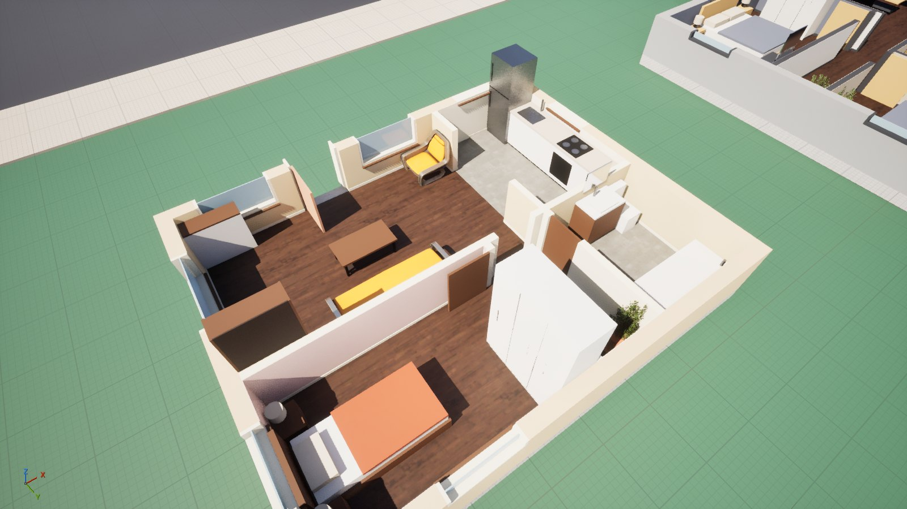

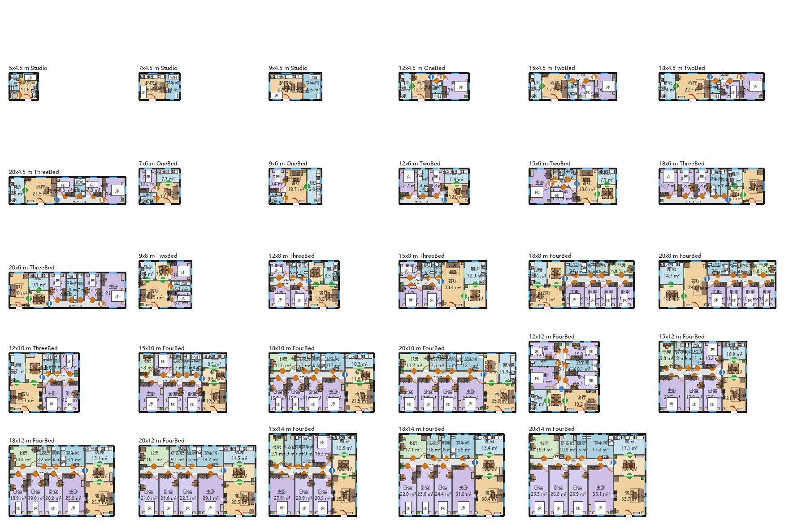

---

## 7. 偏差与已知限制

实现时的裁决（计划台账 `.superpowers/sdd/2026-10-28-pyinterior/progress.md`）：

| 裁决 | 为什么 | 代价 |
|---|---|---|
| 房间最小尺寸收紧（§4.3） | 规格原表连墙算进去，放不进规格下限 5 × 4.5 m 的单间 | 房间比规格表略紧 |
| 走廊 130 / 净宽 95（规格 110 / 120） | 120 的走廊在两道内墙之间只剩 108 净宽，沿外墙 89，每个带走廊的布局都通不过自己的最小值 | 走廊略宽 |
| 加储藏间填充、Gallery 模板 | 没有户型房间的翼也要有房间，房间才能铺满足迹；单靠走廊模板很多外形没有解 | 有的房子多一间储藏间 |
| 居室要 90 cm 能开窗的外墙；正门在唯一窗墙上时挪到墙端 | 正门居中时 T / U 形的客厅没窗 | 这些房子的正门在墙端 |
| 摆家具按紧凑户型的做法（推拉门、90 cm 通道、湿区 55、单间厨房 75、单人床先行、所有顺序 + 替代件） | 扫描里最紧的房间否则没有合规摆法 | 净空比宽敞户型的做法紧 |
| `SM_Chair` 做扶手椅（规格以为是餐椅） | 实测是休闲椅（82 × 81 × 115，和沙发同材质） | 餐椅、书桌椅仍是拼装件 |
| 不用 `SM_Shelf`、`SM_Lamp_Wall` | 挂墙装饰要另写摆放规则 | 两个网格没用，书架仍是拼装件 |
| 真网格由参数 `RealMeshes` 开关 | 阶段模块是纯 Python，看不到资产在不在 | 没有 StarterContent 的工程要手动关 |
| 真网格逐轴缩放到目录尺寸（沙发、扶手椅高度 × 0.74） | 规则只看目录里的盒子 | 比例和原网格略有出入 |
| 保存的关卡：House_04 墙全高，其余降墙 | 不改参数就能看到两种输出 | 想全部升墙要逐栋改 `WallCut` |
| 最小足迹 4.5 × 5 m（规格写 4.5 × 4.5） | 4.5 m 见方连墙算进去放不下单间的起居室加卫生间（审查发现） | 4.5–5 m 见方的房子只出错误 Summary |
| 方案要过家具这一关（规格只说房间尺寸），摆不下就退一个变体 | 两面开口、两面开窗的小厨房会缺冰箱 / 水槽 / 灶（审查在 13.5 × 7 m 上找到，50 cm 普查里共 6 例） | 少数房子比外形放得下的少一间可选房间（普查里 3 / 1905） |
| 卧室等平开门画成开着，卫浴推拉门画成关着（规格写"门扇闭合"） | 开着的门扇看得出往哪开，扫过的地本来就空；推拉门开着就藏进墙里，看不出有门（审查发现） | 要全部画成关着，改 `assemble._doors` 一处 |
| 正面那一翼放不下起居室（2.5–3 m 深）的外形只出错误 Summary | 正门要开进起居室 / 客厅；规格没说这种外形 | 设计者看到的是一条错误，不是房子 |

已知限制：

- 单层房子没有楼梯和阳台（多层房子见 §8）；没有内院、屋顶和天花，没有灯光布置。
- 只支持直角外形，斜边按网格变台阶；房间都是矩形。
- 家具多数是基础几何拼装件 + 4 件 StarterContent 网格；装饰品、门把手、窗帘都没有。
- 每次改外形整栋重算：不保留玩家手摆的家具（生活模拟游戏要的"锁定房间 / 锁定家具"没做）。
- 规则只看房子自身：正门朝 actor 的前方，由摆放的人决定；不看邻居和街道。
- 很窄的房子户型偏小：9 × 4.5 m 仍是 Studio（宽 4.5 m 放不下卧室加走廊）。

---

## 8. 多层（2026-10-29）

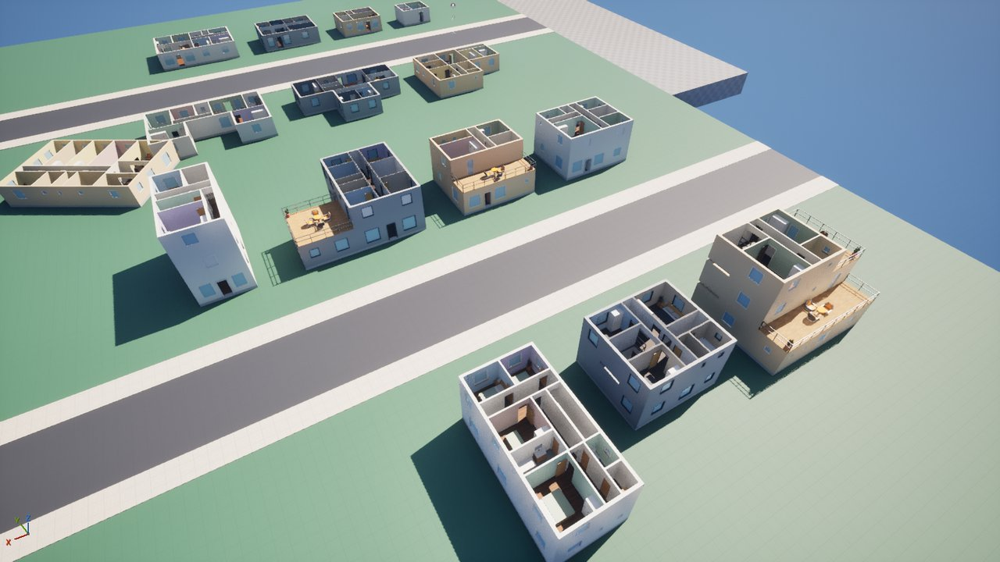

### 8.1 结论

要验证的问题：上面的单层规则能不能扩到多层房子——**每层一条外形、上层可以缩进、缩进露出的屋顶是能走上去的露台**，楼梯把各层
连起来，改哪一层的外形，各层都跟着重排。

- **可行，还是一栋房子一个 Python 节点。** 每层一条闭合样条，按高度归层（层高 = `WallHeight` + 30 cm 楼板 = 300 cm）；上层裁到
  下层以内；下层露出来的屋顶是露台。**先定楼梯，再逐层排**：楼梯间所有楼层同一位置，每层用自己的户型表围着它分区。
- **7 栋示范房全部 0 失败**（两层 5 栋、三层 2 栋；U / L / 单跑三种楼梯；4 块露台），每栋 722–1125 个实例，编辑器里每栋规划
  0.12–0.81 s。
- **单层房子一个不变**：8 栋示范房和 12 个扫描外形的零件逐个和合入前一样（`test_interior_regression.py` 的 20 个摘要）。
- **改外形，各层都重排**：House_11 二层前面缩进 250 cm → 一层、二层都重新排，二层从 Upper_L 降到 Upper_M，前面出现带玻璃门、
  桌椅和栏杆的露台（下图）；House_16 只有一条样条，`Floors` 2 → 3 → 三层 24 间。
- **实时编辑**：带通知地改二层样条，房子自己重算；给房子加一条样条组件、抬高到 600 cm，房子自己变成三层（trap 125）。
- **普查 0 失败**：两层 6–16 × 6–12 m（步长 100）、三层 5–8 × 9–14 m、前 / 后 / 侧缩进 200–400 cm，各 3 个种子，共 708 栋
  （`census.py --storeys`），最慢 1.00 s（随机器负载浮动；终审前同一栋在机器忙时到过 1.57 s，见 §8.6）；117 栋去掉了楼层——这是
  报告不是失败，大多是上层裁剪后小于 4.5 × 5 m。

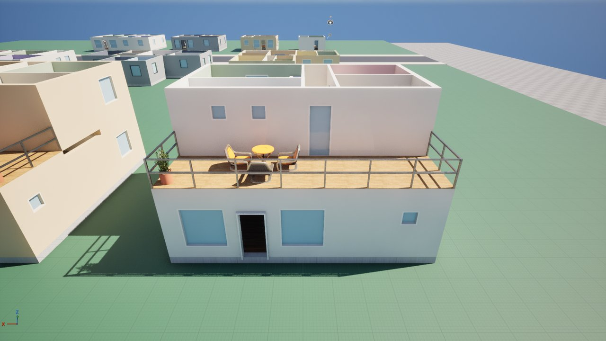

### 8.2 数据流

```
房子 actor（PCGVolume，tag PyInterior_House + PyInterior_Storeys）
 ├─ SplineComponent × 每层一条（第 k 层抬高 k × 300 cm；没有样条的楼层沿用下一层）
 └─ PCGComponent → PCGI_House → Python 节点 i01_house
      storeys.levels / floor_footprints   样条归层、上层裁到下层、太小的楼层去掉（报告）、terrace_rects 露台
      stairs.candidates                    楼梯候选：类型、靠外墙、开口不朝外墙、每层剩余能切成 ≥ 250 cm 的块
      前 6 个候选，每层：floorplan.plan_floor（户型表、块、分区、楼梯开口）→ 门（楼梯开口、露台门）→ 窗 → 家具 → 露台家具
      比较：房间数（必需房间优先）→ 各层分区得分 + 楼梯间面积 + 走廊面积 → 最好的（差 3% 以内由种子挑）
      storeys.parts：每层 assemble.house（一层地基、上层楼板开楼梯洞）+ 楼梯零件 + 露台零件；ShowFloors / WallCut
```

| 文件 | 内容 |
|---|---|
| `pypcg/interior/storeys.py` | 归层、裁剪、露台区域；楼梯循环 `plan_building`、`validate`、`summary`、`room_rows`、`parts` |
| `pypcg/interior/stairs.py` | 三种楼梯的尺寸、开口、候选与排序；踏步、平台、扶手、护栏 |
| `pypcg/interior/floorplan.py` | 围着楼梯切块、一层 / 上层的分区、楼梯开口的"门禁"、每层的缓存 |
| `pypcg/interior/terrace.py` | 露台：门、家具、栏杆、楼板和木平台 |
| `program.py` / `layout.py` / `doors.py` / `openings.py` / `furnish.py` / `checks.py` / `assemble.py` | 只加不改：楼层户型表、楼梯房间与通行、只经开口房间连楼梯、楼梯开口与露台门、楼梯平台留空、上层不要正门、楼板与露台门 |

### 8.3 规则

**归层与裁剪**：样条的楼层 = round((平均高度 − actor 高度) / 层高)；最低的一条算一层（不在 0 层时记说明）；同一层多条取面积最大
的（记说明）；`Floors` = 0 按样条层数，1–3 指定层数（缺样条的层沿用下一层）；最多 3 层。上层的格子 = 自己的格子 ∩ 下一层的
格子（不悬挑），清理后小于 4.5 × 5 m / 20 m² 就去掉，连同上面的楼层（报告）。下一层的格子减上一层的格子 = 露台。

**楼层户型表**（按本层面积减楼梯间）：

| 户型 | 面积起点 | 房间（权重；括号里可删，数字小的先删） |
|---|---|---|
| Ground_S | 0 | 客厅 3.0、厨房 1.3 |
| Ground_M | 32 m² | 客厅 3.0、厨房 1.5、（餐厅 1.4）、（厕所 0.5） |
| Ground_L | 55 m² | 客厅 3.2、厨房 1.6、（餐厅 1.6）、（厕所 0.5、书房 1.5、洗衣房 0.8） |
| Upper_S | 0 | 卧室 2.2、卫生间 1.0（阁楼式：楼梯直接进卧室） |
| Upper_M | 30 m² | 主卧 2.6、卧室 2.1、卫生间 1.1 |
| Upper_L | 50 m² | 主卧 2.7、卧室 2.1、卧室 2.0、卫生间 1.2、（厕所 0.5） |
| Upper_XL | 75 m² | 主卧 2.9、卧室 2.1 × 2、卧室 2.0、卫生间 1.3、（厕所 0.5、书房 1.5、洗衣房 0.8） |

全屋一个主卧：只有顶层保留主卧槽位，下面的上层把主卧改成卧室；顶层户型没有主卧时，顶层最大的、够主卧尺寸的卧室当主卧。

**楼梯**（层高 300 cm 分 17 级，每级 17.6 cm、踏步深 27、梯段宽 100；净尺寸）：

| 类型 | 净尺寸 | 开口 | 用在 |
|---|---|---|---|
| U 形 | 220 × 330 | 一层：起步那一半；中间层：整个短边（到达 + 起步）；顶层：整个短边，下面空的那一半装护栏 | 两层、三层 |
| L 形 | 300 × 330 | 一层：起步的短边；顶层：转角那一侧的远端 | 两层 |
| 单跑 | 110 × 450 | 一层一端，顶层另一端 | 两层（长条房子） |

楼梯间整个落在顶层里、至少一条边贴着每层都是外墙的墙、开口不朝外墙、每层剩下的部分能切成不窄于 250 cm 的块。候选：顶层每段外墙
的两端和中点、每种类型、四个朝向。排序（便宜的启发式）：不占正面外墙、一层开口靠近正门、楼梯靠近顶层中部、面积小的类型。前 6 个
候选逐层规划，比较**房间数**（先比各层户型里的必需房间——上层的卧室和卫生间——再比总数），再比分区得分。`StairType` 强制类型，
层数不适用时退回 Auto（记说明）。

**每层分区**：

- 块：每个翼按楼梯间的四条边切成 3 × 3，角块并到相邻的边块；有窄于 250 cm 的块的切法不用。外墙判断仍按整层足迹（楼梯间四周是
  内墙）。
- 一层：入口块 = 正面外墙最长的块，客厅在里面开正门；公共房间全放入口块，或客厅留在入口块、厨房（和餐厅）放进相邻的块；其余块放
  私密房间（`distribute`）。楼梯开口外面必须是客厅、走廊或餐厅（"门禁"在挑候选布局之前就筛，不然好布局会被挤掉）。
- 上层：楼梯开口外面是走廊（楼梯平台）——开口所在的块套带走廊的模板；或沿楼梯那一边先切一条 130 cm 的平台走廊，块的其余部分从平台
  进入（走廊可以拐进深块）；块太浅、平台后面放不下房间时整块当平台。阁楼（Upper_S）允许开口直接进卧室。
- 分不到房间的块：楼梯开口进它或者别的块从它进入时是走廊，否则是储藏间；块比它分到的房间大 3 m² 以上时，也试一试"房间 + 储藏间"
  （楼梯定了块，一个块只放一个厕所会变成 8 m² 的厕所）。
- 两条走廊并排拼成一个矩形（平台后面紧贴一条 Gallery）不算布局；L 形、T 形相接可以。
- 楼梯和开口房间之间是开口（无门扇），位置就是楼梯的开口；它外面 100 cm × 开口全宽不摆家具（楼梯平台）。
- 每层的单层不变量全部成立（最小净尺寸、居室有窗、每间可达且只有一条通道、家具不挡门……）。

**露台**：

- 门：和露台共墙 ≥ 120 cm 的房间里，按客厅、主卧、卧室、走廊、书房、餐厅的顺序挑一间，开一扇 90 cm 推拉玻璃门；这段共墙不再开窗
  （玻璃门算采光）。
- 家具：短边 ≥ 200 cm 且 ≥ 6 m²：圆桌 + 2–4 把扶手椅（放得下几把放几把，尽量居中）+ 盆栽；≥ 3 m²：盆栽；短边 < 120 cm 或没有
  门的露台只装栏杆。家具离边 15 cm，门前 120 cm 留空。
- 拼装：下一层的屋顶楼板 30 cm（外立面色）+ 2 cm 木平台（`Floor_Deck`）+ 105 cm 金属栏杆（立柱间距 ≤ 150、扶手 + 中横杆），只装在
  下面是外墙的那几条边上。

**拼装**：一层照旧有 30 cm 地基；上层下面一块 30 cm 楼板（外立面色）盖住本层足迹、楼梯间开洞，楼梯间里没有地面和踢脚线。踏步块高
= 一级 + 15 cm（下沿连成锯齿底面），平台 20 cm 厚，木色；每跑一根斜扶手（踏步前沿连线上 90 cm）；U 形顶层开口下面空的那一半装护栏。
`ShowFloors` = k 只生成 1..k 层，第 k 层按 `WallCut` 降墙，下面的楼层保持全高；被隐藏的上一层不画，第 k 层的楼梯只画到墙顶（剖切
视图里能看到楼梯脚）。顶层没有屋顶。

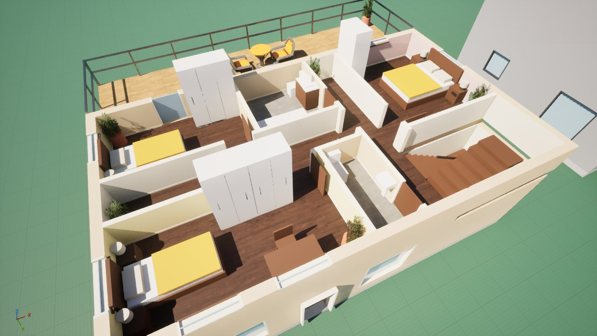

### 8.4 用法

离线：

```
C:\Python314\python.exe Tools/pyinterior/plan.py --storeys       # Saved/Reports/pyinterior_storeys_<房子>.png，各层平面并排
C:\Python314\python.exe Tools/pyinterior/census.py --storeys     # 708 栋多层房子的普查，约 5 分钟
```

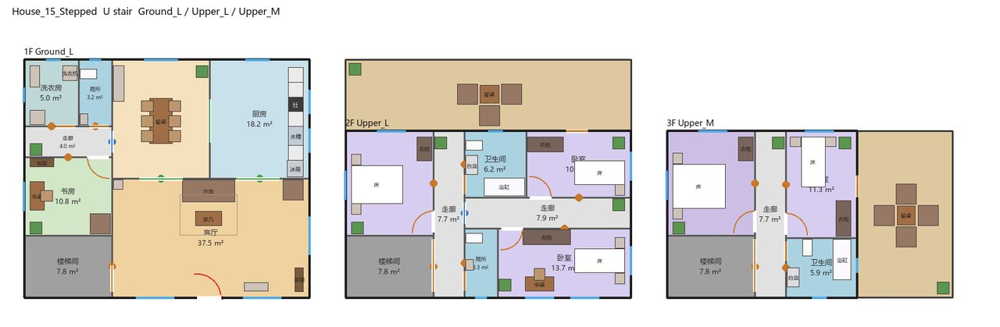

编辑器（`pyinterior.py`）：

| 阶段 | 做什么 |
|---|---|
| `site` | 两条街一起铺（第二条街在 y = −6500） |
| `houses {"set": "storeys"}` | 只删、只建 7 栋多层房（每层一条样条，第 k 层抬高 k × 300 cm），不动原来 8 栋；`houses` 不带参数只管原来 8 栋 |
| `assign` | 两组一起：多层房加上自己的 `Floors` / `StairType`，示范街的降墙也放回去（重建图会清掉覆写，trap 124） |
| `view {"house"?, "floors": k, "wallcut": 100}` | 改 `ShowFloors` / `WallCut` 并重新生成（不给 house 就是全部多层房）；下一次调用再拍；`{"floors": 0, "wallcut": 0}` 还原 |
| `shape {"house", "floor": k, "points" \| "size" \| "shape"}` | 改第 k 层的外形（没有这一层的样条就加一条）；房子重算 |
| `shot {"house", "view": "room", "room": "Corridor", "floor": 1}` | 某一层某个房间里人眼高度拍 |
| `read` / `status` | 加了 `floors`、各层户型、`stair`、`terraces`、`dropped`、`notes`；`status` 列出每条样条在第几层 |

参数（房子 PCG 组件，原有参数不变，`Program` 只管单层）：

| 参数 | 默认 | 作用 |
|---|---|---|
| `Floors` | 0 | 0 = 按样条的层数；1–3 = 指定层数（缺样条的层沿用下一层的外形） |
| `ShowFloors` | 0 | 0 = 全部楼层；k = 只生成 1..k 层，第 k 层按 `WallCut` 降墙 |
| `StairType` | Auto | Auto / U / L / Straight |

加一层：在 Details 里给房子加一个 Spline 组件、画好、整体抬高 300 cm（或用 `shape {"floor": k}`）。

### 8.5 结果（编辑器实测，2026-10-29）

| 房子 | 外形 | 户型 | 楼梯 | 房间（含各层楼梯间） | 露台 | 实例 | 失败 |
|---|---|---|---|---|---|---|---|
| House_11_TwoStorey | 10 × 8，两层同形 | Ground_L / Upper_L | U | 16 | 0 | 795 | 0 |
| House_12_FrontTerrace | 10 × 9，二层前面缩进 300 | Ground_L / Upper_M | U | 13 | 1 | 722 | 0 |
| House_13_LTerrace | L 14 × 11，二层只盖一个翼 | Ground_L / Upper_XL | L | 18 | 1 | 978 | 0 |
| House_14_Townhouse | 5.5 × 11，三层同形 | Ground_M / Upper_M / Upper_M | U | 16 | 0 | 744 | 0 |
| House_15_Stepped | 12 × 10 / 12 × 7 / 8 × 7 | Ground_L / Upper_L / Upper_M | U | 21 | 2 | 1125 | 0 |
| House_16_OneSpline | 9 × 8，只有一条样条，`Floors` 2 | Ground_L / Upper_L | U | 16 | 0 | 764 | 0 |
| House_17_LongStair | 6.5 × 13，`StairType` Straight | Ground_L / Upper_XL | 单跑 | 19 | 0 | 877 | 0 |

- 原来 8 栋单层房的实例数不变（143、237、355、540、483、490、486、604）；PCG 日志没有警告。
- 离线：`pypcg` 测试 2094 通过、18 跳过（多层新增约 155 个）；`census.py`（单层）、`census.py --storeys` 见上。

| | |
|---|---|
| 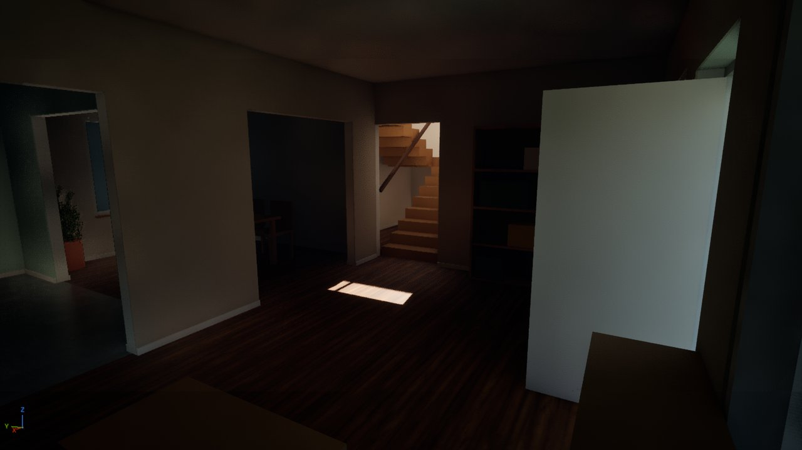 | 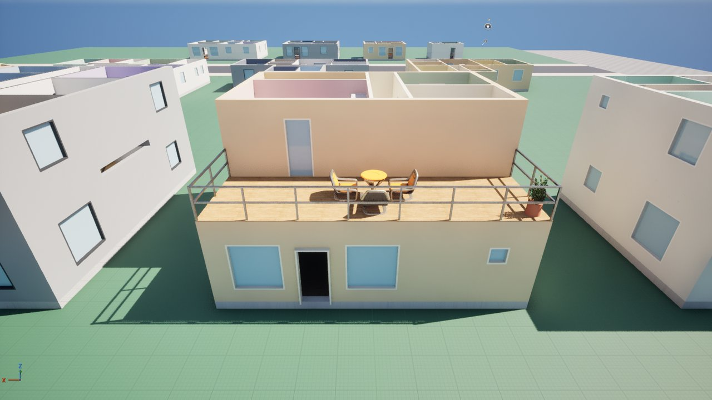 |
| 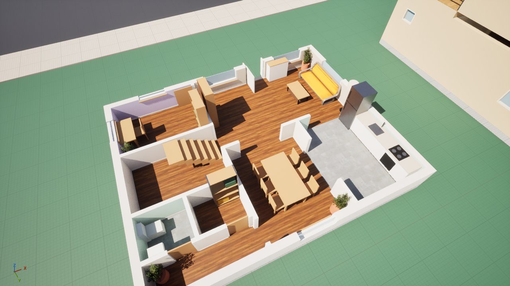 | 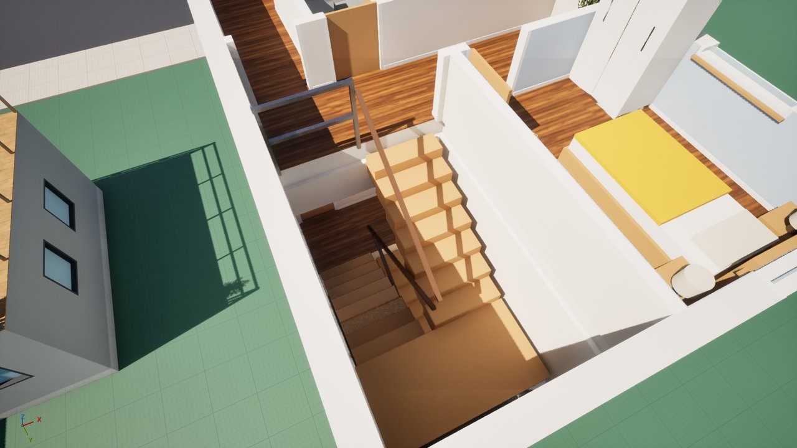 |

### 8.6 裁决与已知限制

实现时的裁决（台账 `.superpowers/sdd/2026-10-29-pyinterior-storeys/progress.md`，摘要）：

| 裁决 | 为什么 | 代价 |
|---|---|---|
| 楼梯候选要求每层剩余能切成 ≥ 250 cm 的块（规格有，计划漏了） | 不然 8 × 7 m 的前 6 个候选有 5 个根本切不出块 | 无 |
| 楼梯开口的"门禁"在挑候选布局之前筛 | 每块只留 4 个最好的布局，带走廊的布局会被挤掉，楼梯就够不着 | 无 |
| 房间按整层面积分配目标，不按所在块 | 块是楼梯定的，按块算 14 × 9 m 会出 27 m² 的书房配 20 m² 的客厅 | 布局取舍不同 |
| 上层多两种进入方式：平台走廊 + 块的其余部分、整块当平台 | U 形顶层 / 中间层的开口有 220 cm 宽，只有 Gallery 模板盖得住；普查里 Upper_L 保住全部房间的楼层 53 → 92 | 平台偏宽 |
| 楼梯位置按房间数比较（先比上层的必需房间），6 个都试，不在凑满 3 个时停 | 按"各自户型丢了几间"比会选中只有一间卧室的阁楼；停在 3 个时 5.5 m 联排的上层都是一卧 | 规划时间约翻倍（最慢 1.00 s） |
| 块比房间大 3 m² 以上时也试"房间 + 储藏间" | House_13 一层出了 12.5 m² 的洗衣房和 8 m² 的厕所 | 有的房子多一间储藏间 |
| 通道连得上但门放不下（共墙够、两头的门框余量不够）的布局不要 | 普查里一间厕所没有门 | 无 |
| 楼梯每层 16 块（17 级里最后一级落在平台或楼上），第二跑 7 级拉长到 30.9 / 28.6 cm | 第二跑要正好落到开口 | 两跑踏步深度不同 |
| 剖切视图里楼梯画到墙顶，不是不画 | 不然隐藏上一层时楼梯间是空的 | 剖切里看得到楼梯脚 |
| 露台门所在的共墙不开窗，玻璃门算采光 | 规格原文"这段墙不再开窗" | 朝露台的房间那面墙只有门 |
| 终审：楼梯间按房子的 `ExteriorWall` / `InteriorWall` 留墙（原来读默认的 25 / 12 cm） | 墙加厚到 40 / 20 cm 时，踏步和平台伸进外墙 15 cm，却不报失败 | 墙厚时楼梯间跟着变大 |
| 终审：露台桌椅只在整套不出平台的位置试；一层的房间尺寸检查在 6 个楼梯位置之间共用 | 普查最慢的房子（16 × 11 m，后面 2 m 露台）机器忙时 1.55 s，超过规格的 1.5 s；结果逐位不变（普查加示范共 715 栋的摘要一致） | 无 |

已知限制：

- 最多 3 层；没有地下室、坡屋顶、屋顶、电梯，不悬挑；顶层没有屋顶（剖切视图）。
- 楼梯只靠外墙（每层都是外墙的那几面），只有三种；三层只用 U 形。上层的短边（面宽或进深）≥ 5.5 m 时 U 形放在前、后、左、右都排得下；
  5 m 及以下放不下 U / L 形（楼梯间连墙 2.6 m，旁边还要留 2.5 m 的块），只剩单跑（连墙 1.5 m 深），而单跑两端的开口不能朝外墙、一层
  还得排得下：10 × 9 m 的房子上面 10 × 5 m（或 10 × 4.5 m）的二层只有放在后半边（前面是露台，单跑贴后墙，Upper_S）能排，放在前半边、
  或者 5 × 9 m 的二层放在左右半边，那一层都会去掉，并在 Summary 的 `dropped` 里报告。
- **没有室内灯光**：上层盖住下层，下层在人眼高度很暗（上图），顶层是露天的所以很亮。
- 5.5 m 宽的联排一层只剩客厅 + 厨房：楼梯占了宽度，比较时上层的卧室优先。
- 每层独立按面积选户型，不做跨楼层的总户型平衡；楼梯平台走廊有时沿正面，那一段立面没有窗。
- 分步预览脚本 `pyinterior_steps.py` 仍只支持单层。
