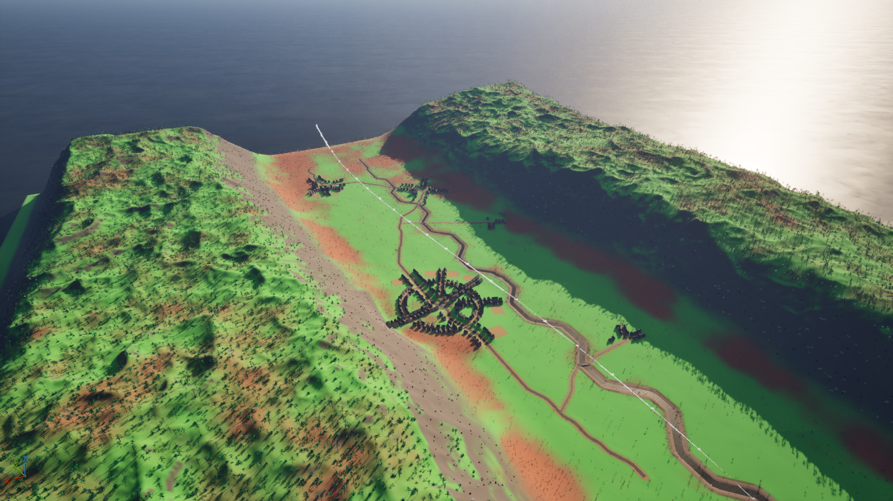
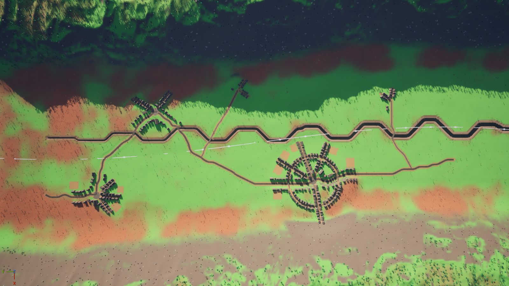
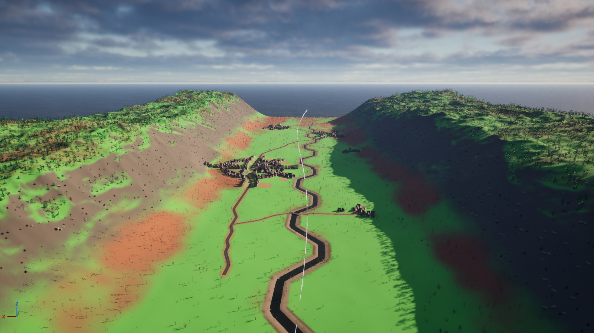
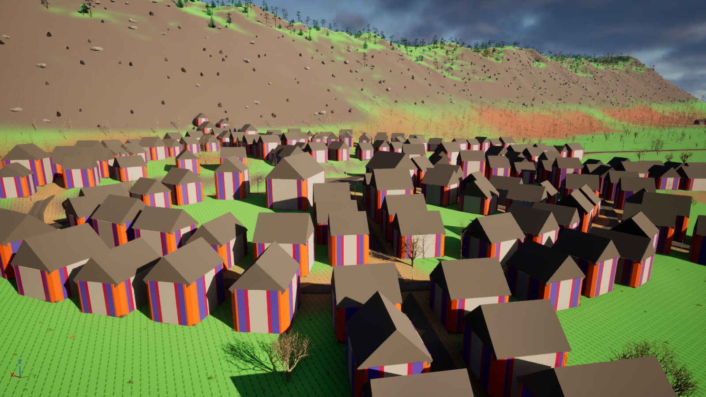
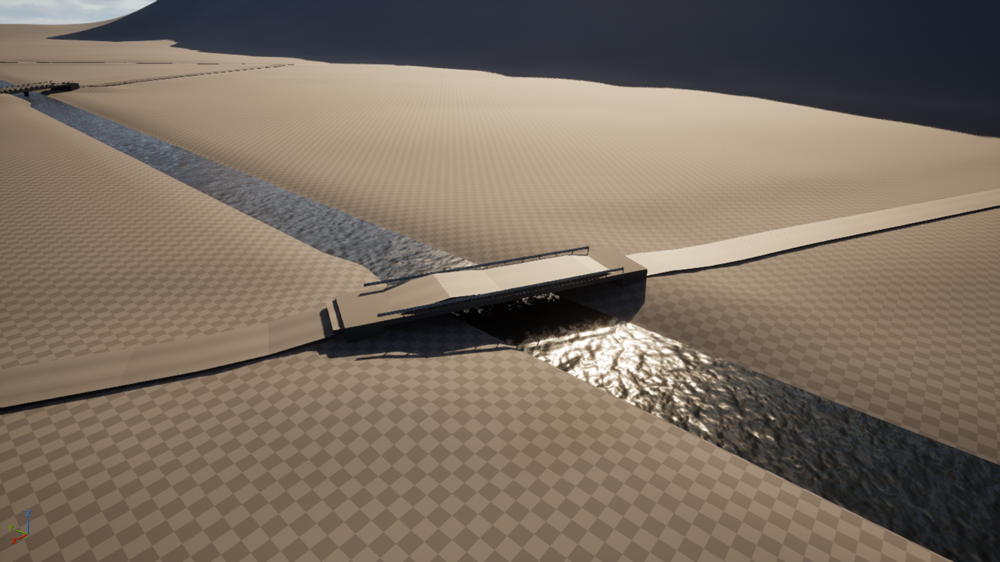

# PyWorld 指南 —— 按《Building Worlds with Houdini》的流程，用 PCG 图 + Python 节点生成山谷世界

> 适用于：人和 AI。要改布局、改参数、重跑某一步、看结果，都从这里开始。
> 设计：`docs/superpowers/specs/2026-10-22-pyworld-video-pipeline-design.md`；计划：`docs/superpowers/plans/2026-10-22-pyworld-video-pipeline.md`。
> 分支 `pyworld-pipeline`，2026-10-22。



---

## 1. 视频拆解

视频：Benoit Martinez（Ubisoft Paris）在 Houdini HIVE Paris 的演讲《Building Worlds with Houdini》，
讲《幽灵行动：荒野 / 断点》开放世界的管线（https://www.youtube.com/watch?v=bQ_U1_MVKJQ ，58 分钟，只有法语自动字幕）。

| 步骤 | 视频里怎么做 | 本项目对应 | 时间 |
|---|---|---|---|
| 0 地形底图 | 高度图 + 遮罩 | W1 地形 | 06:28 |
| 1 地形数据层 | 任意点可查高度、朝阳、材质、流向，地形一改就重算 | 各阶段从同一个 MeshTerrain 读，W7 自算坡度 / 谷底高度 / 汇流 | 12:51–15:45 |
| 2 地点 | 美术放兴趣点 | W2 地点（关卡里的 TargetPoint） | 16:27 |
| 3 道路 | A\* 寻路，扩大邻域（16 方向）让路贴地形；新路接已有路网；按路平整地形 | W4 道路 | 16:27–21:04 |
| 4 河流 | 同一套寻路，容差不同；交叉自然出现 | W3 河流 | 19:56–20:28 |
| 5 桥 | 路跨河处生成桥 | W5 桥 | 20:28、28:54 |
| 6 聚落 | 平整、内部街道、从中心向外分区、建筑规则表 | W6 聚落 | 33:07–38:57 |
| 7 植被与岩石 | 放弃生态模拟，用区域遮罩 + 散布规则，沿路清空，密度可控 | W7 植被岩石 | 22:49–28:17 |
| 8 沿路道具 | 电线杆间的电线；道路轨迹复用 | W8 沿路道具 | 03:36、22:14 |
| 9 地表材质 | 各遮罩合成地表材质 | W9 地表材质 | 42:37 |
| 10 校验与重跑 | 检查卡点、贴地；每晚整链重跑 | `pyworld.py check` / `reset` + 按序 `gen` | 25:09、40:52 |

不移植：引擎 / 版本管理 / 渲染农场 / 分析 / AI 刷点 / 特效等管线部分；生态模拟（视频里也放弃了）；隧道（MeshTerrain 是高度场）。

---

## 2. 构成

| 部分 | 位置 |
|---|---|
| 阶段模块（全部逻辑，纯 Python，不 import unreal） | `Content/Python/pypcg/stages/w01_terrain.py` … `w09_surface.py` |
| 共享库 | `Content/Python/pypcg/world/`：`noise` `grid`（顶点格高度场）`hydro` `geom` `astar` `terraform` `points` `layout`（控制布局）`rules`（建筑规则表、生物群系表）`settle` `scatter` `checks` `graphs` |
| 9 张图（由 `.py` 生成，不要手改） | `/Game/PyPCG/World/PCGW_01_Terrain` … `PCGW_09_Surface` |
| 关卡 | `/Game/PyPCG/L_PyWorld`（`L_PyCity` 的模板副本，地形定义换成 `MPD_Basic`，存的是生成后的结果） |
| 驱动 | `Content/Python/pyworld.py` |
| 测试 | `Tools/pypcg/tests/test_world_*.py`（离线） |

每张图：参数 getter → 场景读取（MeshTerrain、关卡控制 actor、上游阶段 volume 的输出）→ **一个 Python Data Processor 节点** → 原生
`Write_MeshTerrain` / `Spawn_Assets` / `Assign_ShapeGrammarDefinition` / `Transform_MeshTerrain_Erosion`。
上游产出用 `Get_ActorData` 按 volume 的 tag（`PyWorld_W02` …）读，数据 tag（`River` `Road` `Building` …）随数据走。

| 步 | 读地形 | 写地形 | Python 输出 → 原生节点 |
|---|---|---|---|
| W1 地形 | Base | 子优先级 1（先过原生侵蚀，遮罩 `Mountain`） | `Terrain` |
| W2 地点 | Final（面） | — | `Locations` `RiverEnds` `Exits` |
| W3 河流 | Intermediate 2 | 3 | `Terrain`；`Water` → Spawn（`MI_ocean`）；`River` |
| W4 道路 | Intermediate 4 | 5 | `Terrain`；`Modules` → Spawn；`Roads` |
| W5 桥 | — | — | `Parts` → Spawn；`Bridges` |
| W6 聚落 | Intermediate 6 | 7 | `Terrain`；`Footprints{Low,Mid,High,Tower}` → 4 个建筑形状语法；`Parts` → Spawn；`Buildings` `Streets` `Areas` |
| W7 植被岩石 | Final（点 + 面） | — | `Trees` `Rocks` `Grass` → Spawn；`Trees` |
| W8 沿路道具 | Final（面） | — | `Props` → Spawn |
| W9 地表材质 | Intermediate 8 | 9（`Channels` = Grass Rock ForestFloor Dirt Mud Gravel） | `Terrain` |

每个改地形的阶段都把**全部** 261 312 个顶点写回（只改 z），所以改了上游要从那一步起整链重跑。

### 各阶段做什么

- **W1**：顶点高度 = 沿 `PyWorld_Valley` 样条的谷底（控制点的 z 就是谷底高程，2 % 横坡 + 低噪声）+ 两侧 400 m 升到 180–240 m 山脊（域扭曲值噪声 + 脊状噪声）+ 离中心 1.15–1.48 km 落回 -600 的海底。`Mountain` 属性只让原生侵蚀作用在山体上。
- **W2**：地点在 60 m 内吸附到最平处；半径（actor X 缩放 × 100 m）定类型：≥ 200 m 镇、≥ 120 m 村，其余小村。
- **W3**：隔一顶点（11.7 m）的 A\*：越高越贵、上坡很贵、离开蜿蜒引导线（正弦，振幅 60 m、波长 300 m，种子决定相位）越远越贵、镇村中心半径一半内加罚。水位沿程单调下降，宽 6→20 m，河床下切 1.5 m、1:2 岸坡，水面是随水位倾斜的 Plane。
- **W4**：16 方向 A\*（视频的"扩大邻域"），坡度代价 + 22 % 硬限、入河加罚、已有路打折。干道：南出口 → 镇 / 村（按 y）→ 北出口；小村用多目标搜索接到最近的路。纵断面：60 m 平滑、挖填到 10 % / 14 %、桥上抬到水面 + 2.5 m 并做坡道；路基走廊压平（桥跨除外）；车道模块每 5 m，各自贴写回后的地面。
- **W5**：路线与河中线求交；跨度 = 河宽 / sin(夹角) + 两端 6 m；桥面、每 4 m 护栏、两端桥台、> 14 m 加桥墩。
- **W6**：大的先排。平台（拟合平面、坡度 ≤ 4°、避开路和河）→ 镇 / 村留 18 m 广场 → 教堂（带钟楼）和镇公所占最宽的方向（挡住就在 ±60°、+1.6 m 内找）→ 放射街（镇 5、村 3、小村 2，镇加环街）→ 沿街、沿路按分区从规则表选类型（核心：商铺 / 住宅；住宅区：住宅；外围：农舍 + 屋后农田、谷仓、棚屋）→ 每块垫平 → 恢复路基。足迹按层高分 4 组交给 `SGD_Bldg_B_Advance_Template`；地基、45° 转的方块坡屋顶、尖塔、街面、广场地砖是网格。
- **W7**：坡度、离谷底高度（586 m 窗口最小值）、D8 汇流、离河距离 → 生物群系：岩石（> 34°）、河岸（河边 25 m 或汇流沟）、高山（谷底上 120 m）、森林（> 7° 或 25 m 上）、草甸（成簇的白桦）。7 m 抖动网格按密度取点，清空路、街、河、桥、建筑、广场、农田；高度用地形面自己的射线。草 4.5 m 网格。`Density` 参数就是视频的密度热图旋钮。
- **W8**：路右侧每 40 m 电线杆（镇内、桥上跳过），两根电线按 0.8 m 垂度分段；路边 3 m 处高差 > 1.5 m 加护栏；街道每 30 m 路灯；广场一圈 6 张长椅。
- **W9**：每顶点 6 个通道权重（坡度→Rock，树密度→ForestFloor，路 / 街 / 广场 / 农田→Dirt，河岸→Mud，河床与干道路肩→Gravel，剩下 Grass），和为 1。

---

## 3. 怎么用

一次调用一个阶段（`run_unreal_script("pyworld.py", {...})`）；生成是异步的，`gen` 后等 30–150 s 再 `read`。

```
{"phase": "build", "stages": "all", "defer": true}   # 9 张图 → /Game/PyPCG/World，0 diff 才保存（改了 PARAMS / 接线 / DOC 才需要）
{"phase": "make"}                                     # 只在第一次：L_PyCity → L_PyWorld
{"phase": "layout"}                                   # 只在第一次或改了 layout.py：控制 actor、9 个 volume、MPD_Basic
{"phase": "assign"}                                   # 挂图（build 之后必做：重建图会清组件覆写，trap 91）
{"phase": "reset", "from": 1}
{"phase": "gen", "stage": N}  →  {"phase": "read", "stage": N}      # N = 1..9，按序；read 给出验收结果 pass_ok / failures
{"phase": "tops"}                                     # 建筑语法各层高组的墙顶（rules.WALL_TOP 要等于它）
{"phase": "check", "defer": true}                     # W10：植被侵入、桥数、连通、坡度、贴地
{"phase": "shot", "view": "top|wide|valley|street"}   # 一次一张；近景加 {"centre": [x,y,z], "radius": cm, "tag": "x"}
{"phase": "compare"}                                  # pass 1 对 pass 2（gen / read 带 {"pass": 2}）
{"phase": "save"}                                     # 只存 L_PyWorld
```

- **改布局**（挪地点、改河端 / 出口、改山谷走向）：改 `pypcg/world/layout.py` → `layout` → `assign` → `reset {"from": 1}` → 1..9。
- **改参数**：每张图的用户参数都能在 volume 的 PCG 组件上覆写（Details 面板），或 `assign {"overrides": {"7": {"Density": 1.5}}}`；之后从该步重跑。
- **改算法**：改 `stages/wNN_*.py` 或 `world/*.py`，跑 `C:\Python314\python.exe -m pytest Tools/pypcg/tests -q`，再从该步重跑；Python 节点每次生成都重新加载模块，不用重建图。
- **编辑器在后台时截图不落盘**：`tl_editor_no_throttle.py {"throttle": false}`，用完 `{"throttle": true}`。

---

## 4. 结果（2026-10-22）

| 步 | 结果 | Python 秒 |
|---|---|---|
| W1 | 261 312 顶点；山脊最高 322 m；沿轴线实测谷底误差 41 cm | 13.1 |
| W2 | 5 个地点（中心最大坡度 3.5°）、2 个河端、2 个出口 | 0.01 |
| W3 | 河长 2 646 m，水位单调，下切 1 254 个顶点，266 块水面 | 8.7 |
| W4 | 6 条路（4 干 2 支）3 133 m，连通，最大坡度 10.0 % / 14.0 %，1 590 个车道模块 | 8.7 |
| W5 | 4 座桥 = 4 个交叉，最大跨度 28.6 m | 0.02 |
| W6 | 314 栋：镇 184、村 ≥ 51、小村 ≥ 14；每个镇 / 村 1 座教堂；0 重叠，0 压路 / 街 / 河；10 块农田；21 905 个实例 | 9.0 |
| W7 | 23 771 棵树、4 031 块石头、10 215 丛草；河岸桤木占比 0.60（全图 0.030） | 8.1 |
| W8 | 47 根杆（平均间距 39.9 m）、1 278 段电线、82 盏路灯、18 张长椅、12 段护栏 | 0.08 |
| W9 | 6 通道，权重和误差 2e-16；覆盖 Grass 57 % / Rock 30 % / ForestFloor 12 % | 14.5 |

W10 校验：树的侵入 0（路 / 街 / 河 / 建筑 / 广场 / 农田 / 桥）；交叉 4 = 桥 4；路网连通；坡度在限内；抽查 4 577 个树 / 路灯实例，贴地误差 > 30 cm 的 0 个。
W10 的范围比 spec 成功标准 3 窄：贴地只抽查树和路灯，侵入只查树；建筑与路 / 街 / 河的重叠由 W6 的 Summary（`overlaps`、`on_road`）给出。
两遍对比（审查修正前的一轮）：除 W6 外每一步每种网格的实例数相同；W6 见 §5。关卡存了生成结果：179 个文件共 94 MB，最大 19 MB。






---

## 5. 偏差与已知限制

- **W6 的原生建筑语法偶发多放一面墙**：Python 输出逐项相同（342 栋、Summary 相同），三次生成 `SM_Bldg_Wall_L` 为 2 540 / 2 541 / 2 540。
  所以"两遍逐网格相同"在 W6 差 1 个实例（spec 成功标准 4 未完全达到）。审查修正（地块离开路基走廊、街道绕开已有建筑、护栏探测点移到走廊外）
  之后只重跑了 W6–W9 一遍，没有再做第二遍对比。
- **建筑语法的实测限制**（2026-10-22）：足迹任一边 < 约 8 m、Size 450（Low）或 2 400（Tower）时，整个语法节点失败（"Grammar does not fit for this spline" /
  OffsetSpline 基数错误），这一组一栋都不生成。现在棚屋 8–9.5 m、钟楼 9 m（`rules.MIN_EDGE`），Low 600、Tower 1 950；墙顶 = Size（`tops` 实测）。
- **河的蜿蜒是引导线 + 11.7 m 网格**：俯视能看出折线感；更圆滑要加密网格或对路径再做样条拟合。
- **镇路相交处车道可能抬起至多约 0.5 m**（车道贴写回后的地面，地面在两条走廊交界处有折角）；桥跨上也铺了车道（spec 原写不铺），比桥面高 10 cm。
- **地块离路至少 16 m**（路基走廊在 W6 最后恢复，走廊内的垫平会被覆盖），所以沿路的房子有前院；坡上墙脚仍可能埋入约 0.2 m（5.86 m 顶点网格）。
- spec 里没做的小项：地块 / 农田的坡度剔除、放射街用局部 A\*（现在是直线）、小村 1–2 条街（现在总是试 2 条）。
- 河在平坦谷底由引导线决定走向，不会去找地形上不存在的弯。
- 隧道不做；视频的管线部分（版本、农场、分析）不做。
- 美术是灰盒：建筑是 PCGPrimitives 的模板语法，桥 / 电线杆是基础形体。
