# PyWorld 指南 —— 按《Building Worlds with Houdini》的流程，用 PCG 图 + Python 节点生成山谷世界

> 适用于：人和 AI。要改布局、改参数、重跑某一步、看结果，都从这里开始。
> 设计：`docs/superpowers/specs/2026-10-22-pyworld-video-pipeline-design.md`；计划：`docs/superpowers/plans/2026-10-22-pyworld-video-pipeline.md`。
> 分支 `pyworld-pipeline`，2026-10-22。


---

## 1. 视频拆解

视频：Benoit Martinez（Ubisoft Paris）在 Houdini HIVE Paris 的演讲《Building Worlds with Houdini》，
讲《幽灵行动：荒野 / 断点》开放世界的管线（https://www.youtube.com/watch?v=bQ_U1_MVKJQ ，58 分钟，只有法语自动字幕）。

| 步骤 | 视频里怎么做 | 本项目对应 | 时间 |
|---|---|---|---|
| 0 地形底图 | 高度图 + 遮罩 | W1 地形 | 06:28 |
| 1 地形数据层 | 任意点可查高度、朝阳、材质、流向，地形一改就重算 | 各阶段从同一个 MeshTerrain 读，W7 自算坡度 / 谷底高度 / 汇流 | 12:51–15:45 |
| 2 地点 | 美术放兴趣点 | W2 地点（关卡里的 TargetPoint） | 16:27 |
| 3 道路 | A\* 寻路，扩大邻域（16 方向）让路贴地形；新路接已有路网；按路平整地形 | W4 道路 | 16:27–21:04 |
| 4 河流 | 同一套寻路，容差不同；交叉自然出现 | W3 河流 | 19:56–20:28 |
| 5 桥 | 路跨河处生成桥 | W5 桥 | 20:28、28:54 |
| 6 聚落 | 平整、内部街道、从中心向外分区、建筑规则表 | W6 聚落 | 33:07–38:57 |
| 7 植被与岩石 | 放弃生态模拟，用区域遮罩 + 散布规则，沿路清空，密度可控 | W7 植被岩石 | 22:49–28:17 |
| 8 沿路道具 | 电线杆间的电线；道路轨迹复用 | W8 沿路道具 | 03:36、22:14 |
| 9 地表材质 | 各遮罩合成地表材质 | W9 地表材质 | 42:37 |
| 10 校验与重跑 | 检查卡点、贴地；每晚整链重跑 | `pyworld.py check` / `reset` + 按序 `gen` | 25:09、40:52 |

不移植：引擎 / 版本管理 / 渲染农场 / 分析 / AI 刷点 / 特效等管线部分；生态模拟（视频里也放弃了）；隧道（MeshTerrain 是高度场）。

---

## 2. 构成

| 部分 | 位置 |
|---|---|
| 阶段模块（全部逻辑，纯 Python，不 import unreal） | `Content/Python/pypcg/stages/w01_terrain.py` … `w09_surface.py` |
| 共享库 | `Content/Python/pypcg/world/`：`noise` `grid`（顶点格高度场）`hydro` `geom` `astar` `terraform` `points` `layout`（控制布局）`rules`（地块表、原型表）`settle` `grammar`（立面语法）`kit`（建筑模块库）`bdf`（样式库）`building`（单栋装配）`scatter` `checks` `graphs` |
| 9 张图（由 `.py` 生成，不要手改） | `/Game/PyPCG/World/PCGW_01_Terrain` … `PCGW_09_Surface` |
| 关卡 | `/Game/PyPCG/L_PyWorld`（`L_PyCity` 的模板副本，地形定义换成 `MPD_Basic`，存的是生成后的结果） |
| 驱动 | `Content/Python/pyworld.py` |
| 测试 | `Tools/pypcg/tests/test_world_*.py`（离线） |

每张图：参数 getter → 场景读取（MeshTerrain、关卡控制 actor、上游阶段 volume 的输出）→ **一个 Python Data Processor 节点** → 原生
`Write_MeshTerrain` / `Spawn_Assets` / Static Mesh Spawner / Spawn Dynamic Mesh / `Transform_MeshTerrain_Erosion`。
上游产出用 `Get_ActorData` 按 volume 的 tag（`PyWorld_W02` …）读，数据 tag（`River` `Road` `Building` …）随数据走。

| 步 | 读地形 | 写地形 | Python 输出 → 原生节点 |
|---|---|---|---|
| W1 地形 | Base | 子优先级 1（先过原生侵蚀，遮罩 `Mountain`） | `Terrain` |
| W2 地点 | Final（面） | — | `Locations` `RiverEnds` `Exits` |
| W3 河流 | Intermediate 2 | 3 | `Terrain`；`Water`（连续网格）→ Spawn Dynamic Mesh（`M_PyWorldStream`）；`River` |
| W4 道路 | Intermediate 4 | 5 | `Terrain`；`Modules` → Spawn；`Roads` |
| W5 桥 | — | — | `Parts` → Spawn；`Bridges` |
| W6 聚落 | Intermediate 6 | 7 | `Terrain`；`Modules`（建筑模块，网格 + 材质按属性）→ 原生 Static Mesh Spawner；`Parts`（街面、广场地砖）→ Spawn；`Buildings` `Streets` `Areas` |
| W7 植被群落 | Final（点） | — | `Trees` `Shrubs` `Grass` `Ground` `Debris` `Rocks` → 6 个原生 Static Mesh Spawner（草 / 地被带剔除距离）；`Trees` |
| W8 沿路道具 | Final（面） | — | `Props` → Spawn |
| W9 地表材质 | Intermediate 8 | 9（`Channels` = Grass Rock ForestFloor Dirt Mud Gravel） | `Terrain` |

每个改地形的阶段都把**全部** 261 312 个顶点写回（只改 z），所以改了上游要从那一步起整链重跑。

### 各阶段做什么

- **W1**：顶点高度 = 沿 `PyWorld_Valley` 样条的谷底（控制点的 z 就是谷底高程，2 % 横坡 + 低噪声）+ 两侧 400 m 升到 180–240 m 山脊（域扭曲值噪声 + 脊状噪声）+ 离中心 1.15–1.48 km 落回 -600 的海底。`Mountain` 属性只让原生侵蚀作用在山体上。
- **W2**：地点在 60 m 内吸附到最平处；半径（actor X 缩放 × 100 m）定类型：≥ 200 m 镇、≥ 120 m 村，其余小村。
- **W3**：隔一顶点（11.7 m）的 A\*：离局部谷底越高越贵（平方）、上坡很贵、平地上一层漂移噪声决定走向、镇村中心半径一半内加罚，平滑成基线；沿基线"走"出 Kinoshita 河曲（每个弯的波长和摆角不同，弯道半径 ≥ 2.2 倍河宽）。水位沿程单调下降，宽 6→20 m（±20 %，弯顶更宽），断面外侧深切、内侧点沙坝，水面是一张连续网格（§7；2026-10-22 版是引导线 + 拉伸 Plane）。
- **W4**：16 方向 A\*（视频的"扩大邻域"），坡度代价 + 22 % 硬限、入河加罚、河岸 20 m 内加罚、低频偏好场、已有路打折；踩上已有路就截断成路口，60 m / 30 m 高斯平滑（§7）。干道：南出口 → 镇 / 村（按 y）→ 北出口；小村用多目标搜索接到最近的路。纵断面：60 m 平滑、挖填到 10 % / 14 %、桥上抬到水面 + 2.5 m 并做坡道；路基走廊压平（桥跨除外）；车道模块每 5 m，各自贴写回后的地面。
- **W5**：路线与河中线求交；跨度 = 河宽 / sin(夹角) + 两端 6 m；桥面、每 4 m 护栏、两端桥台、> 14 m 加桥墩。
- **W6**：大的先排。平台（拟合平面、坡度 ≤ 4°、避开路和河）→ 镇 / 村留 18 m 广场 → 教堂（带钟楼）和镇公所占最宽的方向（挡住就在 ±60°、+4 m 内找）→ 有机生长的小巷（§7）→ 沿街、沿路按分区从地块表选类型（核心：联排商铺 / 住宅；住宅区：住宅、半联排；外围：农舍 + 屋后农田、谷仓、棚屋）→ 屋后的附属房和菜园（剩余地块）→ 每块垫平、楼面向街道高度靠、台地切挖 → 恢复路基。每栋楼按样式码由 Megascans 模块装配（立面语法、转角、门、道具、四坡顶，§8；2026-10-22 版是一个模板形状语法 + 45° 方块屋顶）。
- **W7**（2026-10-23 起是分层生态群落，§6）：顶点格上的生态场（坡度、离谷底高度、D8 汇流、离河 / 路 / 建筑距离、阴阳坡、湿度、
  森林潜势 + 两层噪声的曲折林缘）→ 每个样本一个群落：林内、林缘、草甸、河岸、山地、岩坡、村边。按层放：成簇岩石 → 按冠幅留间距的乔木
  → 灌木（林缘、河岸、林窗）→ 农田和路边树篱 → 大树下的根、落叶、常春藤 → 倒木 / 树桩 / 枝 → 河岸卵石 → 成丛地被（花各有斑块）→
  1.3 m 网格的草毯。高度按地形三角面精确插值（引擎沿 (i,j)–(i+1,j+1) 切格子），小植物、倒木、石头贴坡。
- **W8**：路右侧每 40 m 电线杆（镇内、桥上跳过），两根电线按 0.8 m 垂度分段；路边 3 m 处高差 > 1.5 m 加护栏；街道每 30 m 路灯；广场一圈 6 张长椅。
- **W9**：每顶点 6 个通道权重（坡度 34–46° →Rock，树密度→ForestFloor，路 / 街 / 广场 / 农田→Dirt，河岸→Mud，河床与干道路肩→Gravel，剩下 Grass），和为 1。

---

## 3. 怎么用

一次调用一个阶段（`run_unreal_script("pyworld.py", {...})`）；生成是异步的，`gen` 后等 30–150 s 再 `read`。

```
{"phase": "build", "stages": "all", "defer": true}   # 9 张图 → /Game/PyPCG/World，0 diff 才保存（改了 PARAMS / 接线 / DOC 才需要）
{"phase": "make"}                                     # 只在第一次：L_PyCity → L_PyWorld
{"phase": "layout"}                                   # 只在第一次或改了 layout.py：控制 actor、9 个 volume、MPD_Basic
{"phase": "assign"}                                   # 挂图（build 之后必做：重建图会清组件覆写，trap 91）
{"phase": "reset", "from": 1}
{"phase": "gen", "stage": N}  →  {"phase": "read", "stage": N}      # N = 1..9，按序；read 给出验收结果 pass_ok / failures
{"phase": "check", "defer": true}                     # W10：植被侵入、桥数、连通、坡度、贴地
{"phase": "shot", "view": "top|wide|valley|street"}   # 一次一张；近景加 {"centre": [x,y,z], "radius": cm, "tag": "x"}
{"phase": "shot", "eye": [x,y,z], "look": [x,y,z]}     # 行人视角（眼高 1.7 m）；不给 z 就向下打射线（会打到树冠 / 屋顶）
{"phase": "compare"}                                  # pass 1 对 pass 2（gen / read 带 {"pass": 2}）
{"phase": "save"}                                     # 只存 L_PyWorld；要提交的话先 reset {"from": 1}
```

- **仓库里的关卡不带生成结果**（控制 actor、谷轴样条、地形、9 个 volume，共 10 MB；生成后 449 MB，W7 一个文件 361 MB，超过 GitHub
  的 100 MB 上限）：打开后先 1..9 依次 `gen` / `read`（约 10 分钟）。要提交关卡改动，先 `reset {"from": 1}` 再 `save`；生成后存的盘只留在本地，不提交。
- **改布局**（挪地点、改河端 / 出口、改山谷走向）：改 `pypcg/world/layout.py` → `layout` → `assign` → `reset {"from": 1}` → 1..9。
- **改参数**：每张图的用户参数都能在 volume 的 PCG 组件上覆写（Details 面板），或 `assign {"overrides": {"7": {"Density": 1.5}}}`；之后从该步重跑。
- **改算法**：改 `stages/wNN_*.py` 或 `world/*.py`，跑 `C:\Python314\python.exe -m pytest Tools/pypcg/tests -q`，再从该步重跑；Python 节点每次生成都重新加载模块，不用重建图。
- **编辑器在后台时截图不落盘**：`tl_editor_no_throttle.py {"throttle": false}`，用完 `{"throttle": true}`。
- **改建筑样式 / 模块 / 规则**（§8）：改 `world/kit.py` `bdf.py` `rules.py` `building.py` 后先跑测试，再 `pyworld_town_preview.py` 在海面上摆样例楼看（`{"clear": true}` 清掉，从不存盘），
  最后 `reset {"from": 6}` → 6..9。新增色调时跑一次 `pyworld_town_materials.py`（生成 `/Game/PyPCG/World/Town/` 下的子材质）。

---

## 4. 结果（2026-10-22）

| 步 | 结果 | Python 秒 |
|---|---|---|
| W1 | 261 312 顶点；山脊最高 322 m；沿轴线实测谷底误差 41 cm | 13.1 |
| W2 | 5 个地点（中心最大坡度 3.5°）、2 个河端、2 个出口 | 0.01 |
| W3 | 河长 2 646 m，水位单调，下切 1 254 个顶点，266 块水面 | 8.7 |
| W4 | 6 条路（4 干 2 支）3 133 m，连通，最大坡度 10.0 % / 14.0 %，1 590 个车道模块 | 8.7 |
| W5 | 4 座桥 = 4 个交叉，最大跨度 28.6 m | 0.02 |
| W6 | 314 栋：镇 184、村 ≥ 51、小村 ≥ 14；每个镇 / 村 1 座教堂；0 重叠，0 压路 / 街 / 河；10 块农田；21 905 个实例 | 9.0 |
| W7 | 23 771 棵树、4 031 块石头、10 215 丛草；河岸桤木占比 0.60（全图 0.030） | 8.1 |
| W8 | 47 根杆（平均间距 39.9 m）、1 278 段电线、82 盏路灯、18 张长椅、12 段护栏 | 0.08 |
| W9 | 6 通道，权重和误差 2e-16；覆盖 Grass 57 % / Rock 30 % / ForestFloor 12 % | 14.5 |

W10 校验：树的侵入 0（路 / 街 / 河 / 建筑 / 广场 / 农田 / 桥）；交叉 4 = 桥 4；路网连通；坡度在限内；抽查 4 577 个树 / 路灯实例，贴地误差 > 30 cm 的 0 个。
W10 的范围比 spec 成功标准 3 窄：贴地只抽查树和路灯，侵入只查树；建筑与路 / 街 / 河的重叠由 W6 的 Summary（`overlaps`、`on_road`）给出。
两遍对比（审查修正前的一轮）：除 W6 外每一步每种网格的实例数相同；W6 见 §5。当时生成后的关卡 179 个文件共 94 MB，最大 19 MB；仓库里的关卡不带生成结果（见 §3）。


---

## 5. 偏差与已知限制

- ~~**W6 的原生建筑语法偶发多放一面墙**；**建筑语法足迹边 < 8 m 整组失败**（trap 94、95）~~ → 2026-10-27 起建筑不再用模板语法，
  由 Python 按样式库装配 Megascans 模块（§8），模块数逐项确定。
- ~~**河的蜿蜒是引导线 + 11.7 m 网格**：俯视能看出折线感~~ → 2026-10-27 改为 Kinoshita 河曲 + 连续水面（§7）。
- **镇路相交处车道可能抬起至多约 0.5 m**（车道贴写回后的地面，地面在两条走廊交界处有折角）；桥跨上也铺了车道（spec 原写不铺），比桥面高 10 cm。
- **地块离路至少 16 m**（路基走廊在 W6 最后恢复，走廊内的垫平会被覆盖），所以沿路的房子有前院；坡上墙脚仍可能埋入约 0.2 m（5.86 m 顶点网格）。
- spec 里没做的小项：地块 / 农田的坡度剔除。（放射街已于 2026-10-27 换成有机生长的小巷，§7。）
- ~~河在平坦谷底由引导线决定走向~~ → 2026-10-27 起由漂移噪声决定（§7）。
- 隧道不做；视频的管线部分（版本、农场、分析）不做。
- 美术：建筑是 Megascans 模块（§8）；桥、电线杆仍是基础形体。

---

## 6. 植被生态群落（2026-10-23）

设计：`docs/superpowers/specs/2026-10-23-pyworld-vegetation-ecology-design.md`。目标：3A 级的自然、丰富，高面数资产。

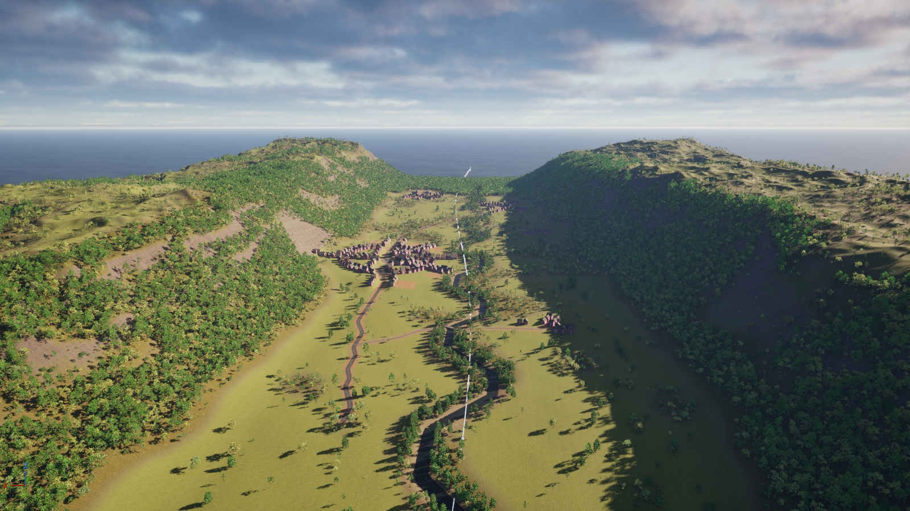
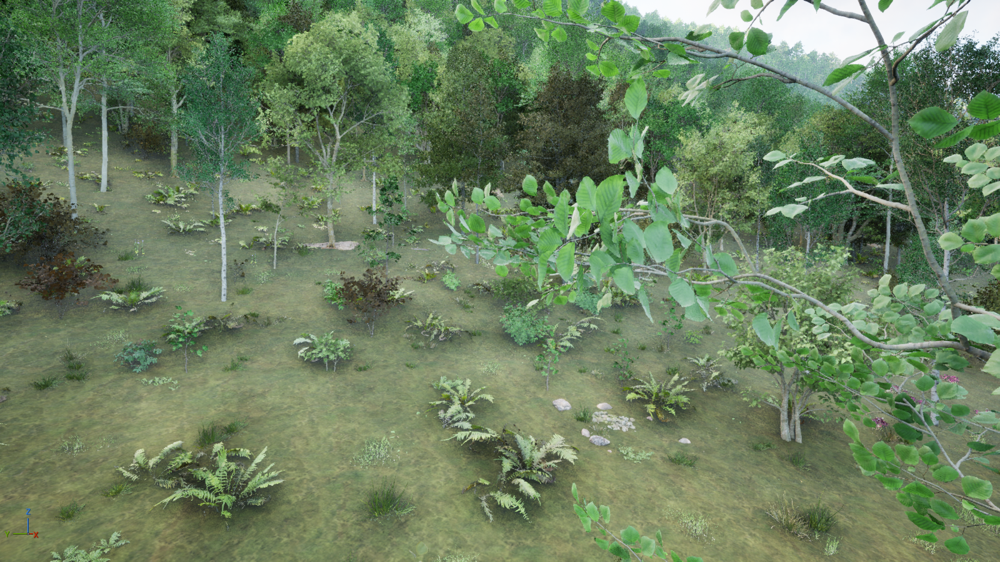
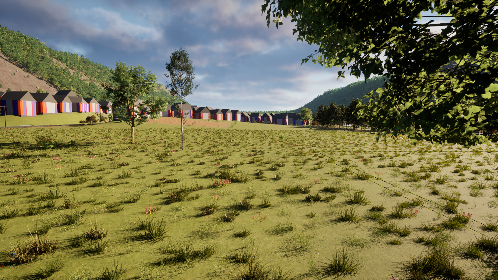
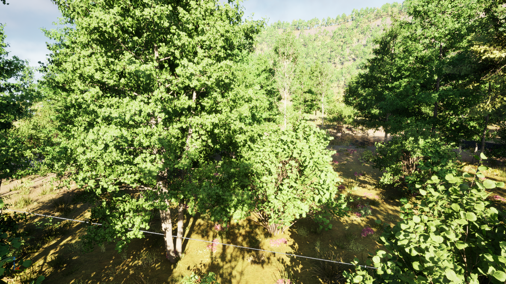

| 部分 | 位置 |
|---|---|
| 物种表（48 种，每种：网格、层、缩放、下沉、贴坡、冠幅间距 / 成丛规则） | `pypcg/world/flora.py` |
| 生态场、群落、各群落的物种配比 / 花斑块 / 接受率 | `pypcg/world/ecology.py` |
| 各层的放置逻辑 | `pypcg/world/grow.py` |
| 阶段 | `pypcg/stages/w07_vegetation.py`（参数 `Density` `ShrubDensity` `GroundDensity` `GrassDensity` `RockDensity` `DebrisDensity` `Extent` `DetailHalf`） |
| 资产拷贝（Electric Dreams → `/Game`，按包引用闭包，702 个文件 9.75 GB，不进 git） | `Tools/pyworld/ed_closure.py --copy` |
| 夏季乔木（Megaplants 的绿色副本） | `pyworld_megaplant_summer.py` → `/Game/PyPCG/World/Trees/` |
| 地表材质（MPD_Basic 的 6 通道换成 Megascans 扫描贴图） | `pyworld_terrain_material.py {"assign": true}` → `M_PyWorldTerrain` + `MPD_PyWorld` |
| ED 母材质的各向异性修复 | `pyworld_fix_aniso.py` |

资产来源：乔木是 City Sample Megaplants（山毛榉、槭、山杨、黑桤木、榛，Nanite 装配体）的夏季副本 + Electric Dreams 的欧洲鹅耳枥
（林木、孤立木、幼树、幼苗）+ 枯树；灌木是接骨木、榛、各种幼树；草本 / 地被 / 倒木 / 岩石全部来自 Electric Dreams 的 Megascans。

结果（编辑器实测）：276 万实例（乔木 7.4 万、灌木 3.6 万、草 143 万、地被 116 万、倒木 4.5 万、岩石 2.5 万），用到 48 个物种，
Python 118 s；群落样本：林内 6.9 万、林缘 6.9 千、草甸 3.0 万、河岸 6.8 千、山地 6.8 万、岩坡 2.9 万、村边 6.7 千；河岸桤木占比 0.61（全图 0.04）。
W9 覆盖：Grass 40 % / ForestFloor 39 % / Rock 19 %。W10 校验通过（侵入 0，抽查 4 746 个实例贴地误差 > 30 cm 的 0 个）。
编辑器内存约 24 GB。生成后的关卡 179 个文件 449 MB，**W7 的输出 actor 一个文件 364 MB，超过 GitHub 100 MB 单文件上限**，
所以仓库里的关卡不带生成结果（见 §3）。

踩过的坑（traps 97–101）：
- **Megaplants 没有叶子**：它们是 Nanite 装配体，叶子是体素植被，必须 `r.Nanite.Foliage=1`（只读 cvar，写在 `Config/DefaultEngine.ini`
  `[ConsoleVariables]`，改了要重启并重编 shader）。City Sample 本身关着它。装配体的部件材质被映射到根网格的槽位，所以换根网格的叶子槽就能换颜色；
  City Sample 是秋季色，夏季副本关掉 `Seasons` 和 `Split Base Color Controls`、打开 `Tint BaseColor`。
- **ED 母材质在本项目崩编辑器**：Substrate 混合 GBuffer 下，连了 Anisotropy 的旧材质转换节点会触发 `MaterialShader.cpp:2567` 断言；
  `pyworld_fix_aniso.py` 断开三个母材质的 Anisotropy 输入。
- **140 万个点走 `Spawn_Assets` 会崩**（`GetClassFromAttribute` 与 GC 竞争，trap 61）：W7 改用原生 Static Mesh Spawner（按属性选网格），
  `gen` 期间关自动保存、拉长 GC 间隔，`read` 恢复。
- **Python 建材质时每个属性改动都会触发整材质重编**，100 次把内存推到 100 GB：表达式属性用 `NEVER` 通知，最后只 `recompile_material` 一次。
- **两个编辑器同时跑**（本项目和 PCG_Codex）：杀进程前先看命令行。

限制：花和草都是 Electric Dreams 的 Megascans 单株，远看靠草毯和地表贴图撑；山脊上的 Rock 层仍有浅色裸带；城镇周边树少（牧场设定）。


---

## 7. 道路与水系的形状（2026-10-27）

设计：`docs/superpowers/specs/2026-10-27-pyworld-natural-roads-water-design.md`。用户：道路和水的形状不够自然——道路分布太均匀、太规则；
水的形状要更圆润，不要那么多直线。

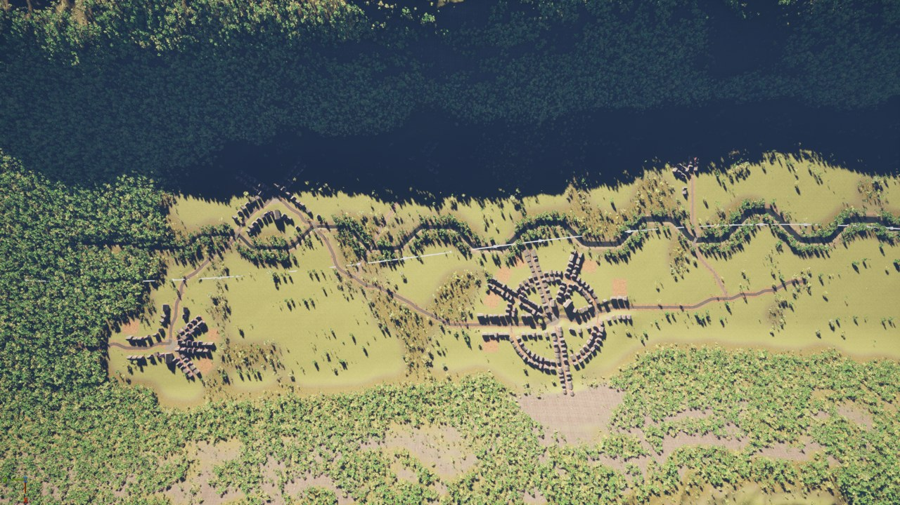
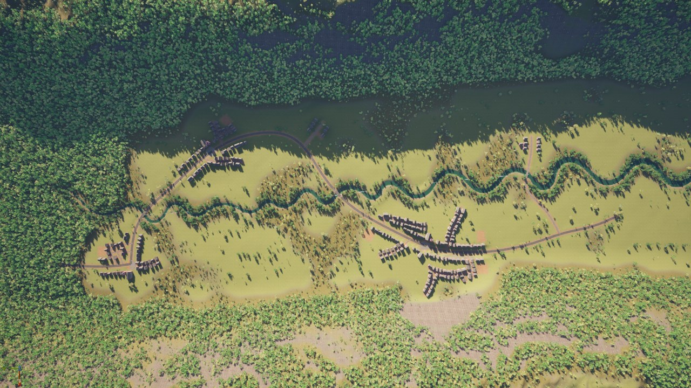

平面图（`Tools/pyworld/offline.py` 用编辑器的捕获数据离线跑 W3→W6，北在上；左改前、右改后）：

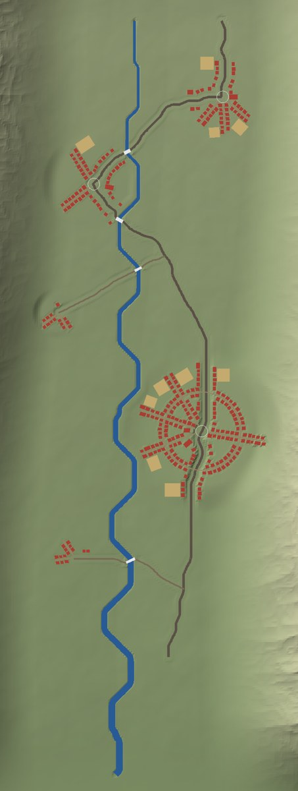 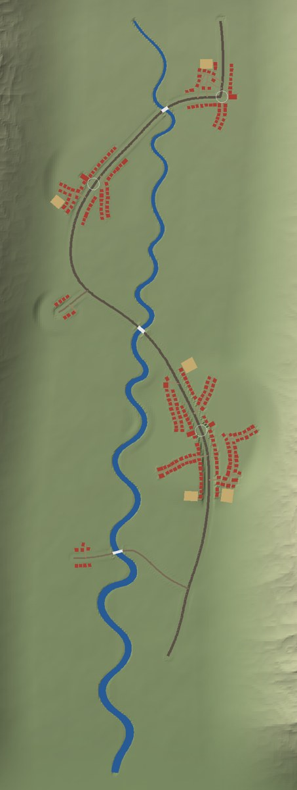

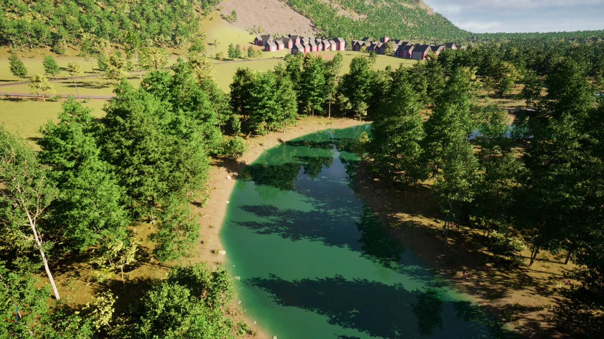
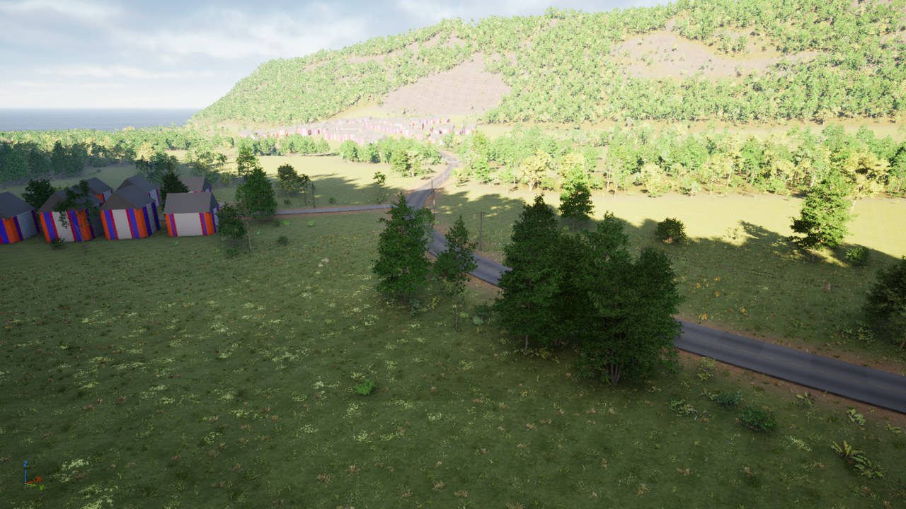
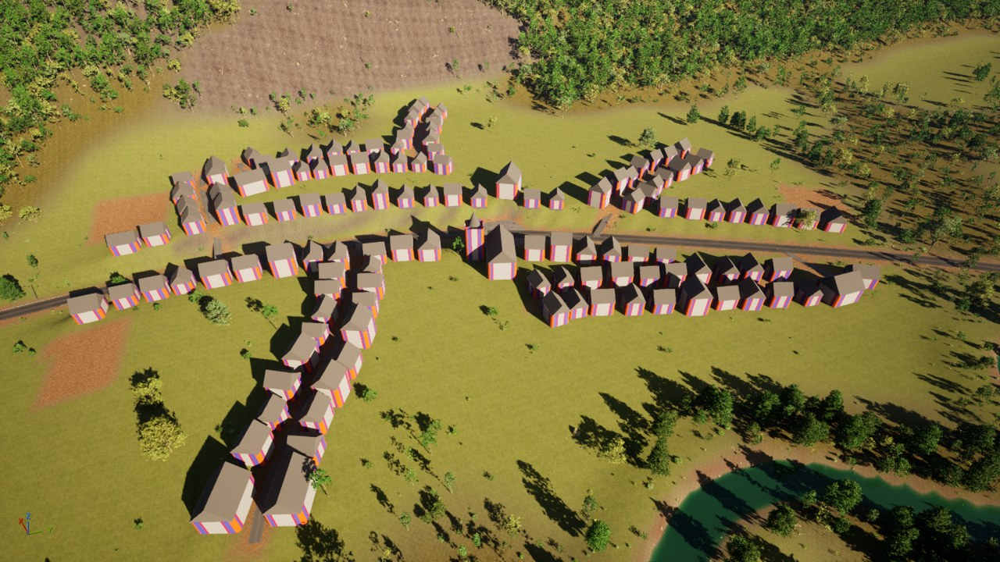
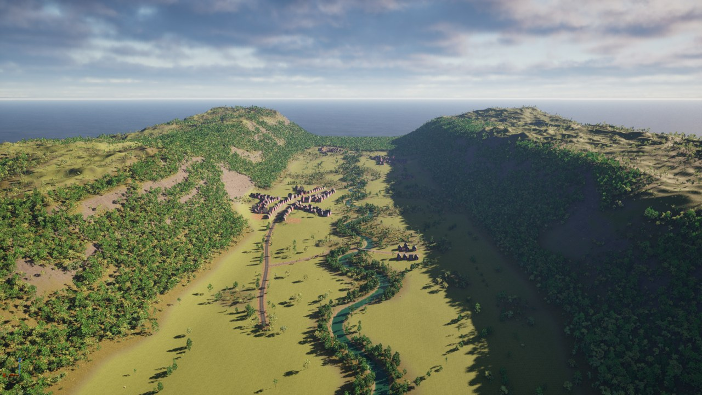

| 部分 | 做法 | 位置 |
|---|---|---|
| 河道走向 | A* 只找谷底（离局部最低处越高越贵，平地上一层 450 m 的漂移噪声决定走向），60 m 高斯平滑成基线；再沿基线每 4 m "走"出河道：航向 = 基线方向 + Kinoshita 河曲角 θ = A sin φ + A³(Js cos 3φ − Jf sin 3φ) − 回拉项。每个弯自己抽波长（0.5–1.9 倍，均值 ≈ 14 倍河宽，最短 180 m）和摆角（0.5–1.3 倍 65°）；陡段、镇旁、两端摆角收小；航向每步最多转 4 m / R（R = 2.2 倍河宽、≥ 25 m），所以没有直段、没有折角 | `stages/w03_river.py`（参数 `MeanderAngle` `MeanderWavelength` `Wander`） |
| 河宽与断面 | 宽度 ±20 % 噪声，弯顶最多宽 25 %（深潭）；弯道外侧深切陡岸、内侧点沙坝（每米升 6 cm 的卵石滩），过渡段浅（浅滩）；顶点只降不升 | `world/terraform.py` `carve_channel` |
| 水面 | 一整张连续网格（每 5 m 一个 7 点横断面，比水边宽 1.5 m 埋进岸里，岸线 = 地形与水面的交线）。新值类型 `geo.Mesh` → `PCGDynamicMeshData` → 原生 Spawn Dynamic Mesh 节点 | `geo/types.py` `Mesh`、`ue/convert.py` `_mesh_data`、`world/graphs.py` `build_w03` |
| 水材质 | Single Layer Water：吸收 / 散射按每厘米（0.035 / 0.014 / 0.02，0.0006 / 0.0011 / 0.0009），浅处见河床、深处转绿；两层法线顺流平移；只在流速快的岸边有一点泡沫 | `pyworld_water_material.py` → `M_PyWorldStream`、`T_PyWorldWaterNormal` |
| 路网 | 代价 × 低频偏好场（`Wander`，300 m）：平地上不走直尺线；离河岸 20 m 内贵 2 倍（`RiverShy`）；后修的路踩上已有道路就截断并在交点接上（T / Y 字路口，不再并行重叠）；干道的各段在镇里不折返时连成一条路一起平滑；60 m（干道）/ 30 m（支路）高斯平滑，路口端点先挪到所接道路上并钉住高度 | `stages/w04_roads.py` |
| 街道 | 不再是等角放射线 + 正圆环路：小巷从广场和穿镇道路上不规则的位置长出来，每 10 m 一步、航向做带衰减的随机游走，可以再分出支巷（镇 2 层、村 1 层），碰到别的街 / 路就并上去成 T 字；镇的边界是一圈噪声；地标先放、街绕开 | `world/settle.py` `grow` `layout` |
| 点沙坝 | River 表多两列：`Curv`（带符号曲率）、`BarW`（沙坝宽），W9 把内岸沙坝刷成 Gravel | `stages/w09_surface.py` |
| 形状度量 | 直线占比（曲率半径 > 1.5 km 的长度）、每 5 m 最大转角、最小半径、弯曲度、重叠长度 | `world/shape.py` |
| 离线环境 | `gen {"capture": true}` 把节点的完整输入存成 `Saved/PyPCG/captures/wNN.pkl`；`offline.py` 用它跑 W3→W6、画平面、量形状（10 s 一轮） | `stage_api.capture`、`Tools/pyworld/offline.py` |

结果（编辑器实测，与离线一致）：

| | 改前 | 改后 |
|---|---|---|
| 河 | 2 646 m，直线占比 65 %，最长直段 110 m，每 5 m 最大转角 27.6°，最小半径 10 m，宽度起伏 1.4 % | 2 858 m，弯曲度 1.23，21 个弯，直线占比 2.1 %，最长直段 5 m，最大转角 11.5°，最小半径 25 m，宽度起伏 7.6 % |
| 水面 | 266 块拉伸平面（每 10 m 一块，直边） | 1 张连续网格 |
| 路 | 6 条（4 干 2 支），直线占比 39–63 %，最长直段 239 m，最大转角 30°，最小半径 9.5 m | 4 条：干道一条 2 156 m 贯穿全谷，直线占比 18 %，最大转角 2.2°，最小半径 130 m；支路最大转角 5.2° |
| 街 | 14 条 2 180 m，直线占比 80 %，镇是"车轮"（5 条放射 + 一圈环路），村是"星形" | 18 条 1 581 m，直线占比 33 %，分枝、T 字路口 |
| 聚落 | 314 栋（镇 184） | 244 栋（镇 133、村 ≥ 41、小村 ≥ 7），0 重叠、0 压路 |
| 桥 | 4 座 | 3 座 = 3 个交叉 |

W10 校验通过（侵入 0、交叉 = 桥、连通、坡度在限内、抽查 4 589 个实例贴地误差 > 30 cm 的 0 个）。离线测试 877 通过。

依据：Kinoshita 曲线是天然河曲的标准模型（Langbein & Leopold 1966 的 sine-generated curve）；河曲波长约 10–14 倍河宽、弯道半径约 2–3 倍河宽
（Leopold & Wolman 1960）；弯道外侧切岸、内侧点沙坝、深潭–浅滩交替（Peytavie et al. 2019, *Procedural Riverscapes*）；路网的代价场 +
复用并入（Galin et al. 2010/2011；育碧 Wildlands / Breakpoint 的道路工具：新路复用并接入已有路网、河流用同一套寻路换容差）。

踩过的坑（traps 102–106）：Single Layer Water 的系数单位是每厘米、`Opacity` 不接就是不透明的镜面；PCG 生成的动态网格不参与贴图流送，
法线贴图停在最低（平的）mip——拷一份设 NeverStream；正在被网格用的材质删不掉、重建要就地清空表达式（SLW 输出节点要单独删）；
A* 的启发式不能超过每厘米最低代价（偏好场 / 复用折扣 < 1 时它会直冲终点）；动态网格三角形的朝向（右手读 (b−a)×(c−a) 的 z < 0 才朝上可见）。
顺手修了 W9 的老 bug：河宽当半宽用，Gravel 往两岸各溢出半个河宽。

限制：
- 河仍是一条（没有支流、牛轭湖）；最窄处 6 m 的上游在 5.86 m 的地形网格上岸线是折的，靠水面网格的软边和岸边植被遮。
- 街道总长比预算短（1.6 km / 约 3.8 km）：小巷碰到河、地标或别的街就停，所以镇的建筑少了约四分之一（184 → 133，规则下限 60）。
- 路面仍是 5 m 一段的车道 / 小路模块（弯道半径 ≥ 130 m 时看不出折），没有换成连续路面网格。
- W7 的输出仍在一个 366 MB 的文件里（生成后的关卡 179 个文件 451 MB），所以仓库里的关卡不带生成结果（见 §3）。


---

## 8. 城镇规则与模块化建筑（2026-10-27）

设计：`docs/superpowers/specs/2026-10-27-pyworld-town-rules-design.md`（第 1 部分是改之前这个场景的城镇规则总结，按 City Sample 的
"阶段 → 规则表"整理；第 2 部分是新规则）。用户："接下来继续优化城镇，需要像 city sample 一样，先总结这个场景的城镇的规则。
要有足够的 pcg 规则和复杂度，特别是建筑模块"。


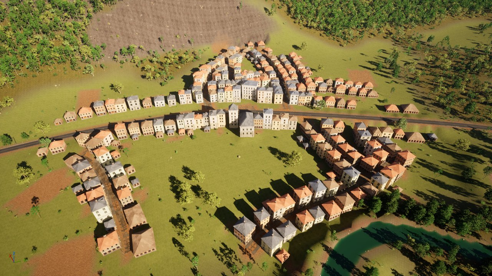
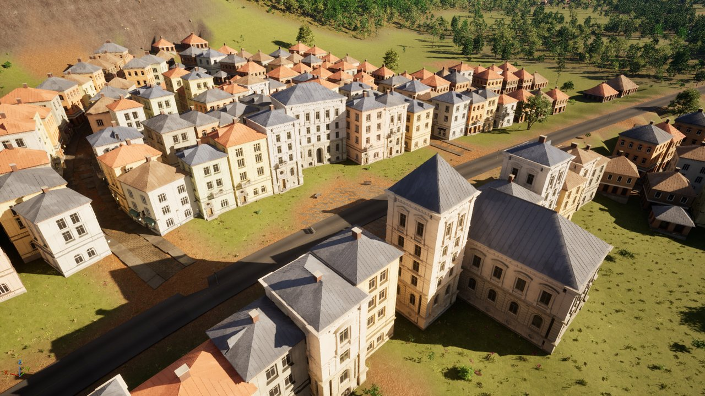
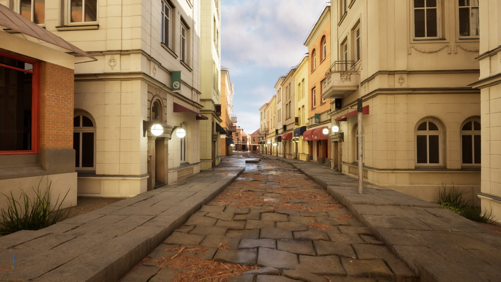
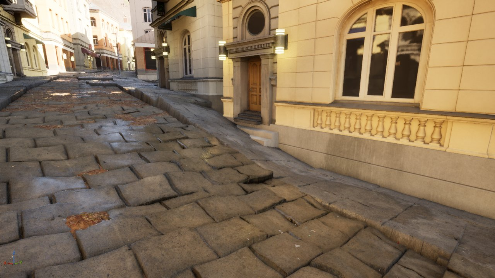
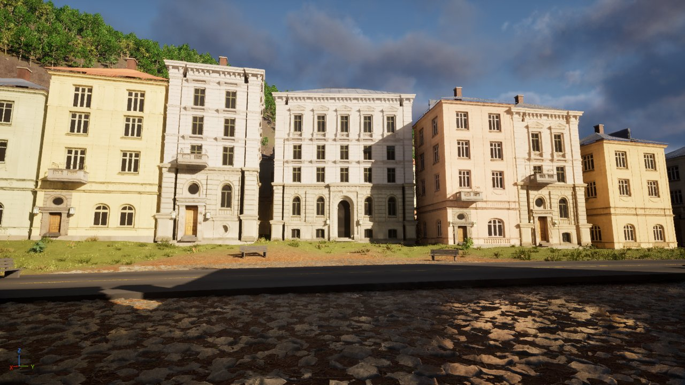
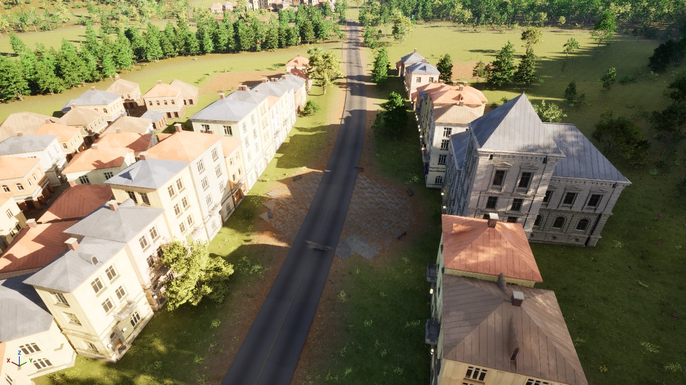
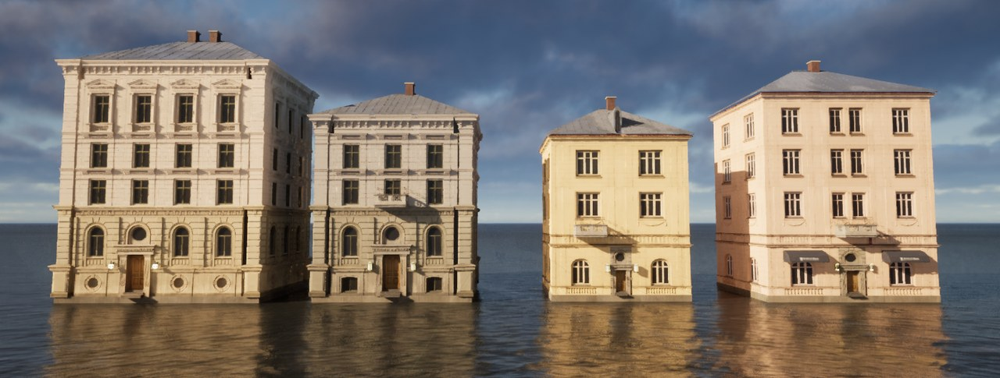
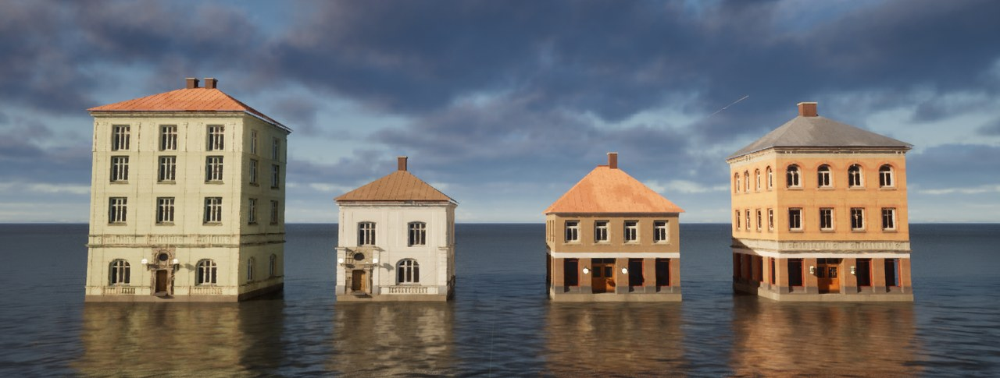
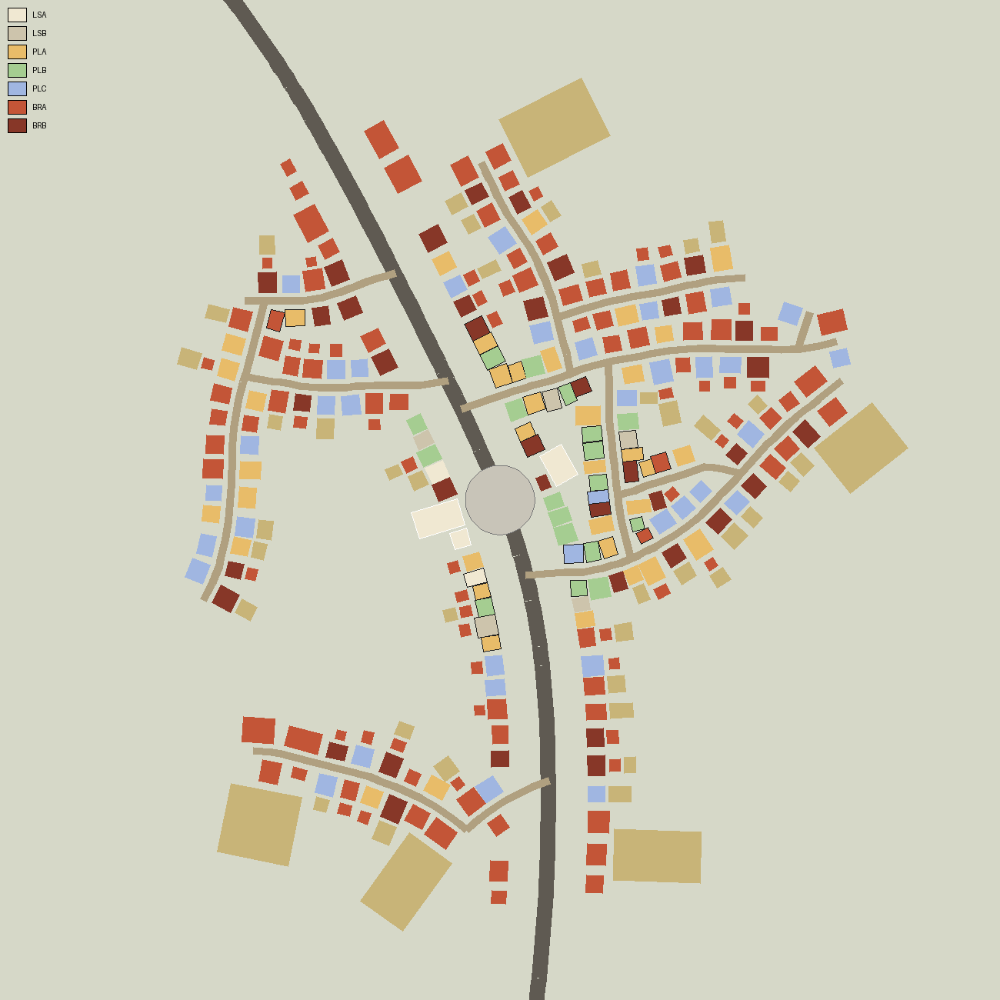

### 8.1 改之前的规则（摘要）

聚落按半径分级（镇 / 村 / 小村）→ 平台（拟合平面 ≤ 4°）→ 18 m 广场 → 教堂 + 钟楼、镇公所 → 有机小巷 → 三个同心分区 →
沿街按地块表（商铺 / 住宅 / 农舍 / 谷仓 / 棚屋，宽深范围、分区权重、按聚落封顶）放地块，留 3–6 m 空隙。**建筑本身只有一条规则**：
按 4 个高度组把足迹交给同一个引擎模板形状语法（彩色条纹调试墙），屋顶是转 45° 的立方体。和 City Sample 比，缺样式码、
竖向 / 水平语法、模块、转角、道具、颜色、高度噪声（spec §1.9）。

### 8.2 新的规则链（City Sample 式）

```
地块（类型、分区、聚落类型、宽深、朝街的边）
  → 原型 rules.ARCHETYPES：样式码白名单与权重（按区、按聚落；石材只在镇）、层数范围、底层用途
  → 样式码 bdf.STYLES（7 个，带 tooltip：外观 / 类型 / 年代）：竖向语法、层数范围、最小墙宽、屋顶、调色板
  → 层数 = 区的范围（村 / 小村的核心区与住宅区低一层）× 聚落高度噪声（70 m 一格），面向广场 +1
  → 竖向语法展开：例 PLA = [G][TR][N][U]*[RT]
  → 每面墙：按跨度选 F0 / F1 / F2（阈值 1 200 / 2 400 cm），解出开间序列（PCG 语法：[S][P,L]*[P,S] …），
    开间统一缩放 0.85–1.2，余量变成角旁的素墙；各层共用一个序列（窗洞上下对齐）
  → 角：每条顺时针边起点放外角模块；石材家族端区 150 cm（角宽逐层 144 / 129 / 115 / 106 / 151，缩放壁柱补齐）
  → 正面：底层门居中（两个 * 段均分），商铺加遮阳篷（每个窗洞）和挑出招牌；石材大门跨基座 + 一层，镇公所 / 教堂大门跨三层；
    门两侧壁灯，门上一层阳台（按样式概率），镇公所铭牌
  → 四坡屋顶（Roof_Kit_00：四个斜脊角块 + 长边直段，按概率换老虎窗段），坡度系数 k 按样式，烟囱 1–2 个
  → 勒脚（灰石灰石，楼面下 4.45 m）、窗后的玻璃面室内块
  → 入口台阶：楼面比门前 60 cm 处的地面高 > 20 cm 时，门前一段石灰石台阶（等分高差、每级 ≤ 25 cm、踏面 32 cm、至多 6 级）
  → 每个模块一个点（变换、Mesh、Mat0）→ 原生 Static Mesh Spawner（网格和 0 号槽材质都按属性）
```

| 样式码 | 家族 | 竖向语法 | 层 | 屋顶 | 用在 |
|---|---|---|---|---|---|
| LSA | 石材古典 | `[FND][L1][T1][L2]*[L3][CR]` | 3–5 | 板岩 k 1.25–1.5，老虎窗 | 镇公所、教堂、钟楼、镇中心 |
| LSB | 石材朴素 | `[FND][L1][T1][L2]*[CR]` | 2–4 | 板岩 | 镇中心联排 |
| PLA | 抹灰 + 花饰主层 | `[G][TR][N][U]*[RT]` | 2–5 | 板岩 / 陶土，老虎窗 | 核心商铺、住宅 |
| PLB | 抹灰 + 阁楼 | `[G][TR][U]*[A][RT]` | 3–5 | 陶土 / 褐 | 核心 |
| PLC | 抹灰 + 粗石底层 | `[GC][U3]*[RT]` | 2–3 | 陶土 / 褐 / 板岩，陡 | 住宅区 |
| BRA | 砖 | `[G][U]*` | 1–3 | 陶土 / 褐，k 1.7–2.1 | 住宅、农舍、谷仓、棚屋、附属房 |
| BRB | 砖 + 米色腰线 | `[G][TR][U2]*[T][RT]` | 2–3 | 陶土 / 板岩 | 住宅、商铺 |

### 8.3 布局与地形的新规则

| 规则 | 值 | 位置 |
|---|---|---|
| 聚落等级定天际线 | 村、小村核心区与住宅区的住宅 / 商铺比镇低一层（至少 1 层）；外围的农舍和地标各处一样 | `rules.RANK_STOREYS` |
| 联排 | 核心区相邻地块空隙 0（共用山墙），住宅区 35 % 概率成半联排；弯道内侧的联排地块依次浅 15 % / 30 % 再放 | `rules.GAPS` `TERRACE_P`、`settle.layout` |
| 剩余地块（City Sample 第 13 阶段） | 街边住宅 / 商铺屋后：附属房（核心 20 %、住宅区 45 %、外围 25 %，门朝主屋）和菜园（Field：W7 围树篱，W9 刷 Dirt） | `rules.BACKYARD` `OUTBUILDING` |
| 镇公所朝向 | 长边朝广场（13 × 18 m）；地标外留 1.2 m 空地，联排不贴地标 | `rules.LANDMARKS`、`settle.LANDMARK_CLEAR` |
| 平台 | 拟合平面的坡度不变，但穿过中心的地面高度（凹坡上最小二乘平面比中心高 6 m，广场曾陷在 6 m 填方里） | `w06.run` |
| 楼面贴街 | 街边房的楼面向门前街道高度靠，最多 60 cm（`STREET_PULL`） | `w06.run` |
| 台地切挖 | 每栋楼外 8.3 m（一个顶点格对角线）内高于楼面的地面切到楼面高度，街道 / 人行道 / 路 / 广场除外；低处由勒脚遮住 | `terraform.cut`、`w06.run` |
| 入口台阶（Hochparterre） | 楼面只向街道高度靠 60 cm，陡坡上门会高出门前地面：高出 > 20 cm 摆石阶，级数 = round(高差 / 17) − 1（1–6 级），等分高差且每级 ≤ 25 cm，踏面 32 cm，比门洞两边各宽 20 cm，向下伸进地面 | `building._steps`；W6 量 `door_rise` |
| 悬空的附属房 | 邻楼的台地切挖会把屋后附属房脚下的地切走（实测一栋离地 3.3 m、门高 4 m）：楼面比脚下平均地面高 > 1.5 m 的附属房不放，地块留作院子（City Sample 也让填不了的地块空着） | `w06.drop_hanging` |
| 街道断面 | 车行道 4 m 铺石块（City Sample `SM_Plaza_Square_E`），核心与住宅区两侧 2.3 m 人行道（`SM_Sidewalk_3_3_A`，高出 13 cm），外围只有车行道；广场铺六角石；Streets 表多一列 `Paved`（植被、W9 按它让开）。每块 3 m 石板坐在引擎自己的三角面地形上（`Lattice.tri_height`；双线性高度在扭曲的格子上差到 16 cm，地面曾整片盖住陡街的石块）：9 × 9 网格最小二乘定俯仰 / 侧倾，按网格和格内地形顶点抬高；人行道板加厚到 1 m（抬高处底下不露缝），石块保持 42 cm（它是带石块起伏的 4 cm 皮，Z 拉得越长石缝越深：拉到 84 cm 时地面盖得只剩石块顶） | `rules.SIDEWALKS`、`w06.street_modules`、`scatter`、`w09` |

### 8.4 部件

| 部分 | 位置 |
|---|---|
| 立面语法（PCG 语法子集：`[]` `*` `+` 数字 `{A:w}`；按缩放最接近 1 求解，两个 `*` 均分；余量） | `pypcg/world/grammar.py` |
| 模块库（3 个 Megascans 家族的层、开间、壁柱、角；门、大门、阳台、屋顶、道具、街道断面；色调子材质路径） | `pypcg/world/kit.py` |
| 样式库（7 个样式码，竖向语法、FLengths、正面语法、tooltip） | `pypcg/world/bdf.py` |
| 单栋装配（墙、角、门、道具、屋顶、勒脚、室内块、烟囱、入口台阶） | `pypcg/world/building.py` |
| 原型、分区、空隙、剩余地块、街道断面规则 | `pypcg/world/rules.py` |
| 色调子材质（70 个，`MS_DefaultMaterial` 的 `Albedo Tint`） | `pyworld_town_materials.py` → `/Game/PyPCG/World/Town/` |
| 样例街（海面上摆 12 栋样例楼看效果，从不存盘；`{"only": [8, 7, 0, 1], "pack": 1900, "z": -450}` 按给定顺序排成一排、楼面贴海面，给截图用） | `pyworld_town_preview.py` |
| 离线按样式着色的镇平面 | `Tools/pyworld/offline.py --town` |

### 8.5 结果（编辑器实测，2026-10-27）

| | 改前（§7 结束时） | 改后 |
|---|---|---|
| 建筑 | 244 栋（镇 133、村 ≥ 41、小村 ≥ 7），一个模板语法、4 个高度组、条纹调试墙、45° 方块屋顶 | 433 栋（镇 251、村 ≥ 65、小村 ≥ 16，含屋后附属房；2 栋悬空的附属房不放），7 个样式码，32 413 个模块、116 种网格 + 色调 |
| 立面 | 无门窗语义 | 每栋 1 扇门且都在朝街一面（433 / 433）；143 栋门前有台阶（门最高比门前地面高 1.34 m）；开间缩放 0.80–1.25；43 家商铺 61 个遮阳篷；78 个阳台、680 盏壁灯 |
| 屋顶 | 方块 | 四坡顶（板岩 / 蓝板岩 / 陶土 / 褐），91 个老虎窗，445 根烟囱；钟楼四棱锥 |
| 高度 | 随机 4 组 | 核心平均 3.0 层（村、小村低一层），外围 1.25 层（高度噪声 × 分区 × 聚落等级） |
| 联排 / 剩余地块 | 无 | 44 栋贴邻（核心联排、住宅区半联排）；63 块菜园、屋后附属房 |
| 街道 | 灰色车道条 + 两侧土路肩 | 石块车行道 + 人行道（核心、住宅区），每块石板坐在引擎的三角面地形上（俯仰 + 侧倾）；广场六角石 |
| 地形 | 161 / 433 栋有墙角离地 > 30 cm（最大 1.48 m） | 远离街道处不埋墙（台地切挖）；凹坡平台不再把广场埋在 6 m 填方里 |

W6 的 Python 10.5 s；W10 校验通过（侵入 0、交叉 3 = 桥 3、连通、坡度在限内、抽查 4 731 个实例贴地误差 > 30 cm 的 0 个）。
离线测试 1 027 通过（新增 `test_world_grammar` `kit` `bdf` `building`，`w06` / `graphs` / `geom` / `terraform` / `field` 加测）。
离线按采集数据量街面：3 m 石块板 686 块里 4 块（交口路堤上抬高到了上限 35 cm）地面高出石顶 ≤ 9 cm；32 块有一角比下面的地面
高出超过石块的 42 cm 厚（凹处，多在板底下看不见）；人行道板 1 176 块都不露地、不露缝。

踩过的坑（traps 107–113）：Roof_Kit_00 的斜脊角是 `_01`（`_02` 是天沟），俯视分不出正反四坡顶，要读顶点；`MS_DefaultMaterial`
的 `Albedo Tint` 要同时设 `Albedo Tint Intensity`；家族 01 的子网格丢了材质、窗没有玻璃；模块化套件沿顺时针边摆立面才朝外；
原生生成器按属性覆写材质（`Mat0`）；要坐在可见地面上的东西用三角面高度 `tri_height`，不用双线性的 `height`；石块路面网格是带起伏的
4 cm 皮，Z 拉太长石缝会被地面填满。

### 8.6 限制

- 足迹只有矩形（没有 L 形、转角楼、内院）；联排在弯道外侧留楔形缝；联排里每栋各自一个四坡顶（没有连续屋脊、山墙）。
- 在 5.86 m 的地形顶点格上，街边房朝街一面的上坡墙角会埋进地面一截（街道坡度 × 半个面宽，实测至多约 0.5 m，被人行道挡住）；
  两条街或街与路的交口各有各的高度，交口处石板可能露土。
- 楼面只向街道高度靠 60 cm：门高出门前地面时有台阶（至多 6 级），反过来街面比楼面高的个别门（实测 4 栋 > 30 cm）会被街面挡住一截。
- 遮阳篷和招牌是 City Sample 的美式图案；色调对整张图集着色（百叶窗也被染色）。
- 石材家族（LSA / LSB）只在镇里，村里的教堂和钟楼除外。
- 广场铺的是 City Sample 自己的广场块 `SM_Plaza_Square_A`（石块嵌在泥土里），远看偏土色；路从广场中间穿过。
- 村的核心区低一层后，广场边仍有 3–4 层（面向广场 +1，PLB 至少 3 层）。
- 仓库里的关卡不带生成结果（10 MB）：生成后 179 个文件 449 MB，W7 一个文件 361 MB，超过 GitHub 的 100 MB 上限。打开后按 §3 依次生成 1..9。
